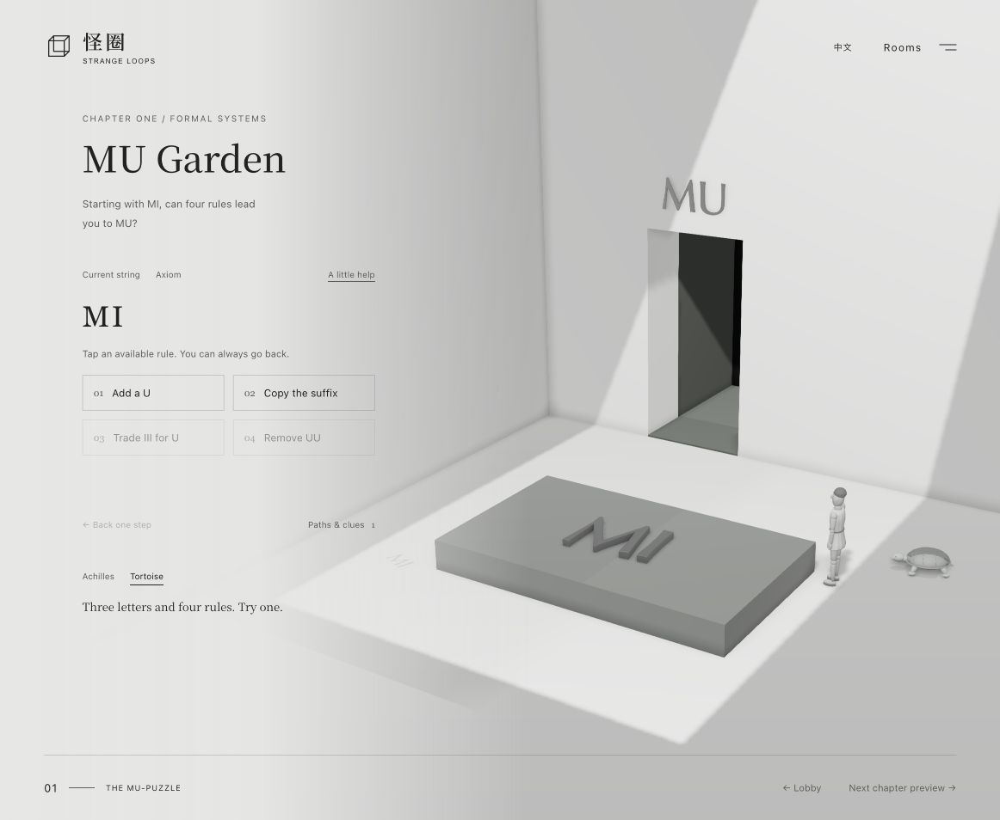
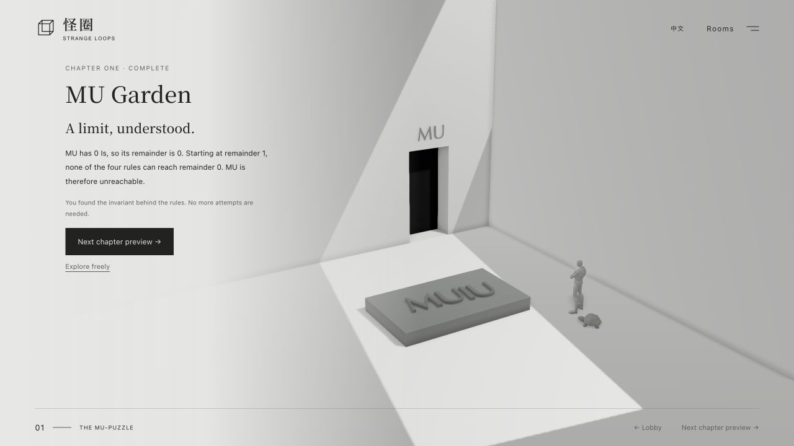
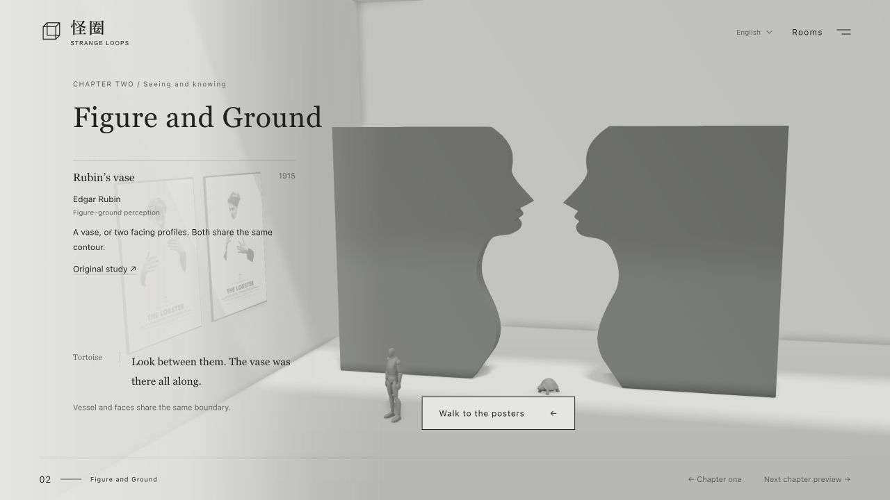

# Strange Loops · 怪圈

[简体中文](README.md) | English

An interactive narrative exhibition in Chinese and English, inspired by *Gödel, Escher, Bach: an Eternal Golden Braid*. The vestibule explores G, E, and B as projections of a single sculpture. Chapter one, MU Garden, lets you rewrite symbols using four formal rules. Achilles and the Tortoise accompany you in both rooms.

Built with Three.js PBR materials, PCSS soft shadows, and GTAO, the vestibule supports drag-to-explore camera controls, three letter views, individual light switches, custom three-letter sculpture generation (`?s=XYZ`), Chinese/English switching, and skeletal idle animations for both characters. The writing is an original tribute. Achilles is adapted from POLLO28’s CC BY 4.0 mannequin; the Tortoise uses a user-supplied Tripo mesh. Both were optimized and adapted for animation in Blender. See [asset credits](THIRD_PARTY_NOTICES.md#achilles-mannequin).


## Model sources

- **Achilles**: adapted from [STYLE Fortnite-creative-mannequin](https://sketchfab.com/3d-models/style-fortnite-creative-mannequin-5da12762b03a40078e21e51a1e185e8c) by POLLO28, licensed under [CC BY 4.0](https://creativecommons.org/licenses/by/4.0/). Changes include mesh reduction, material adjustments, and animation adaptation.
- **Tortoise**: **generated by the user with Tripo**, then cleaned up, simplified, rigged, and adapted for animation in Blender.

The original assets and editable projects are preserved. See the [character documentation (Chinese)](outputs/characters/README.md) and [asset notices](THIRD_PARTY_NOTICES.md).

## Preview locally

The repository includes the built website and models. You can preview it without installing dependencies:

```sh
cd outputs/strange-loop
python3 -m http.server 4173
```

Open <http://localhost:4173>. Serve the files over HTTP rather than opening the HTML file directly.

## Edit and build

```sh
cd outputs/strange-loop
npm ci
npm test
npm run build
npm start
```

The website is static; its publish directory is `outputs/strange-loop`. See the [website README (Chinese)](outputs/strange-loop/README.md) for details on rendering, interactions, and copy.

## Project structure

- `outputs/strange-loop/`: website source, dependency lockfile, build scripts, built JavaScript, sculpture geometry, and character GLB files.
- `outputs/characters/`: editable Blender project, modeling and animation generation script, rendered preview, and [character documentation (Chinese)](outputs/characters/README.md).
- `PRODUCT.md` and `DESIGN.md`: product direction and approved design guidelines, written in Chinese.

The Blender character project includes rigs, materials, and Idle / Walk / Look animation clips. Rebuild instructions are in the character documentation.

## Current scope

The vestibule and chapter one are playable. MU Garden starts with a small goal completed in four taps. Counting Is, grouping them in threes, and checking all four rules reveal the invariant. Choosing the reason MU is unreachable completes and saves the chapter; further exploration is optional. The original four rules apply in one tap, using the leftmost matching occurrence. Hints, undo, and restart are available; history records stay out of the interface. Animated 3D letters follow each rewrite. Progress survives language changes, lobby visits, and reloads. The rule interface also works without WebGL. Chapter three and later rooms are not yet open.

See the [chapter two production plan](outputs/strange-loop/docs/chapter-02-plan.md) (Chinese, with English UI copy and summary). Unreleased rooms are greyed out in the route, with their original topic labels retained.





The repository does not include the book's full text, cover scans, or images of Escher's works. Dependency and font notices are in [THIRD_PARTY_NOTICES.md](THIRD_PARTY_NOTICES.md).

See [publishing under the Gallery Mate website](outputs/strange-loop/docs/deploy-gallerymate.md) (Chinese).

## Chapter two: Figure and Ground

Now playable from the chapter map or chapter one's next button. Two solid, shared-contour walls surround an empty Rubin-style vase. Follow the companions to a number wall: interpret grouped marks, generate 8, check 11, and distinguish absence from evidence in five actions. Progress is validated and saved independently in `geb.figure-ground.v1`, across all seven languages. Two selected *The Lobster* posters hang side by side with an on-page museum label naming the designer, year and sources. The companions walk through chapter one’s WU/MU exit and emerge through the gallery’s side entrance; reduced-motion and fallback modes enter directly. Poster commentary is optional. SVG and HTML provide the same learning path when 3D is unavailable. See THIRD_PARTY_NOTICES.md for artwork provenance.


