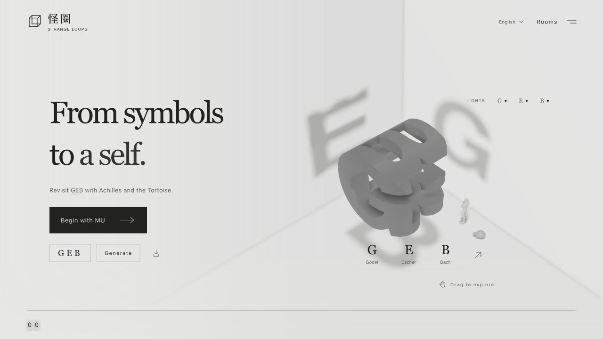
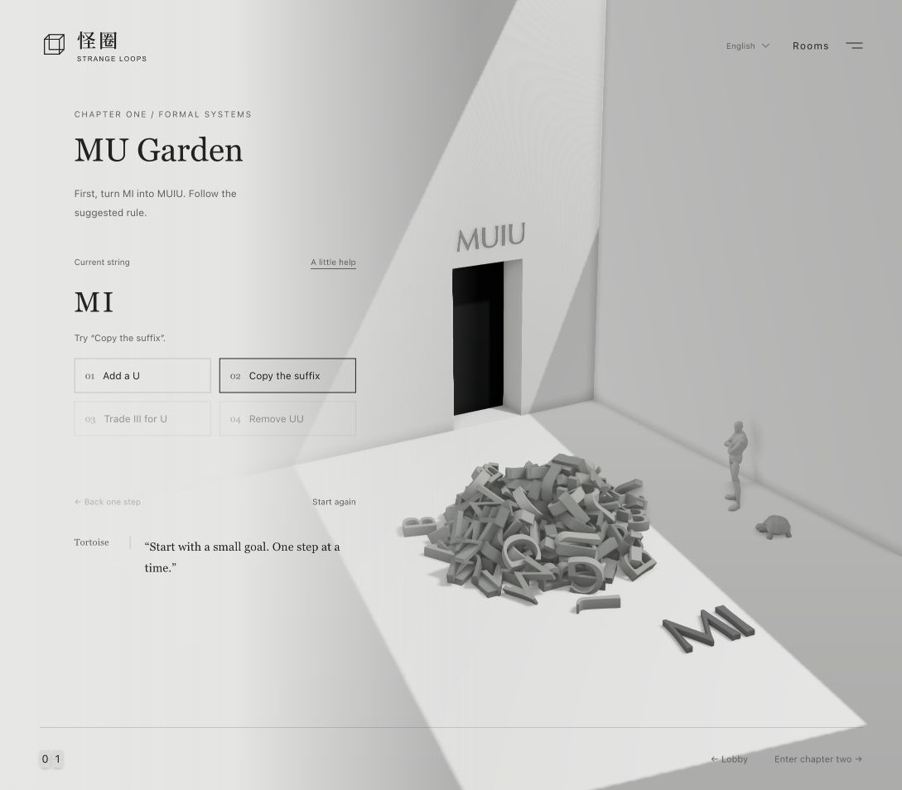
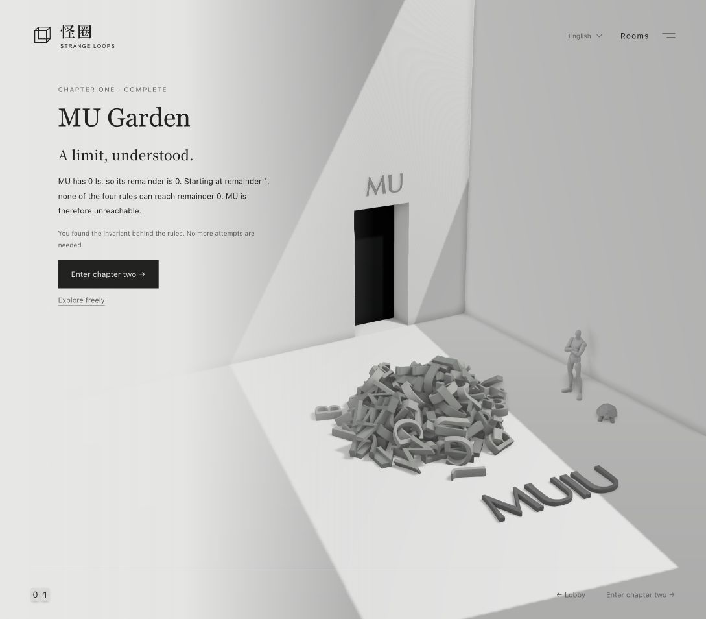
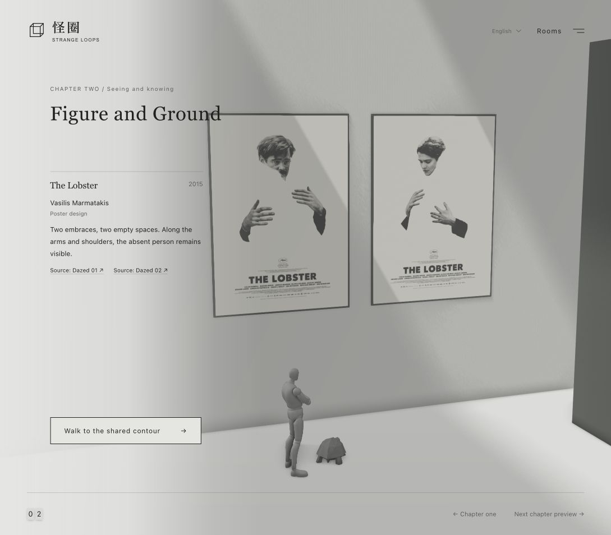
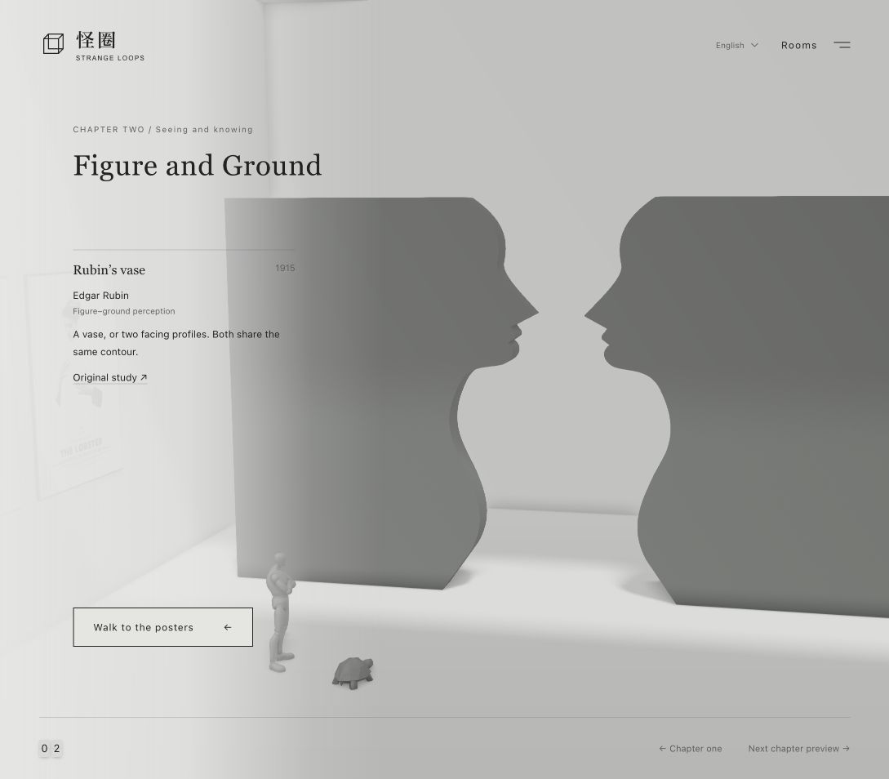

# Strange Loops · 怪圈

[简体中文](README.md) | English

Revisit *Gödel, Escher, Bach: an Eternal Golden Braid* with Achilles and the Tortoise in an interactive 3D exhibition. Explore three projections of one sculpture, rewrite symbols, and shift between figure and ground. Exhibition dialogue and descriptions are original tributes; Chinese terminology follows the Commercial Press edition.

**[Visit the exhibition](https://www.gallerymate.xyz/experiences/geb?lang=en)** · [简体中文](https://www.gallerymate.xyz/experiences/geb?lang=zh) · [Try a custom CAT sculpture](https://www.gallerymate.xyz/experiences/geb?lang=en&s=CAT)

The vestibule and chapters one and two are open. The exhibition supports Chinese, English, Japanese, Korean, French, German, and Spanish; language changes preserve tour and puzzle progress. Chapters three through seven remain in development and appear greyed out on the chapter map.

## Vestibule: Three Projections

One sculpture casts G, E, and B under three perpendicular lights. Drag to explore, choose a letter view, or toggle each light. Enter any three uppercase Latin letters to generate another intersection sculpture in the browser, then download the current model as an STL.



## Chapter one: MU Garden

Follow four suggested rewrites to turn MI into MUIU. Then count the Is, group them in threes, and examine how the four rules affect the remainder to discover why MU is unreachable. Understanding the invariant completes the chapter; further exploration is optional.

Rules apply in one tap, using the leftmost occurrence when several match. Hints, undo, and restart are available. The engine uses the original MIU system throughout; Chinese displays WJU, while the other languages display MIU. Restored derivations are checked step by step, and the 3D letters follow each actual rewrite.





## Chapter two: Figure and Ground

The companions cross the WU/MU doorway into a skylit gallery. Two *The Lobster* posters invite you to find an absent person along the edges of an embrace. Continue to the Rubin shared-contour walls, where two facing profiles enclose a vase. On-page museum labels identify creators, dates, and sources; you can revisit either exhibit.





Achilles jogs through the chapter doorway and uses the Formal walk between exhibits. Gait playback follows actual travel distance. The camera focuses the exhibit and unlocks reading before the companions arrive. This chapter centers on observation and exhibit labels, with no number wall, mathematical quiz, or completion badge.

## Rendering and interaction

- Three.js PBR materials, real-time projected shadows, PCSS soft shadows, GTAO, and FXAA; a monochrome paper-grey palette, without depth of field or background audio.
- A cannon-es simulation in a Web Worker gives the chapter-one letter pile gravity and collisions; the active string appears separately.
- Skeletal idle, look, and locomotion animations; split-flap chapter numbers and a map of available rooms.
- Self-hosted Chinese fonts, keyboard controls, and system reduced-motion support. Without WebGL, chapter-one rules remain playable and chapter two offers SVG and HTML exhibits.

## Preview locally

The repository includes the built website and models. Preview without installing dependencies:

```sh
cd outputs/strange-loop
python3 -m http.server 4173
```

Open the [English preview](http://localhost:4173/?lang=en) or [简体中文](http://localhost:4173/?lang=zh). Serve the files over HTTP.

To edit the source:

```sh
cd outputs/strange-loop
npm ci
npm test
npm run build
npm start
```

`npm run build` updates the main bundle, split-flap styles, and both Workers. Refresh the browser after changes. See the [website documentation (Chinese)](outputs/strange-loop/README.md) for implementation details.

## Publish under Gallery Mate

From a clean, committed revision:

```sh
cd outputs/strange-loop
npm run release
```

The resulting `dist/experiences/geb/` contains seven language pages, runtime assets, notices, and a `release.json` recording the source commit and file SHA-256 hashes. This repository’s CI verifies and uploads the package. To update the website, import it into the GM repository; merging the sync PR triggers GM’s ECS deployment.

See the [deployment guide (Chinese)](outputs/strange-loop/docs/deploy-gallerymate.md) and [chapter-two verification record](outputs/strange-loop/docs/chapter-02-verification.md).

## Assets and repository layout

- **Achilles model**: [STYLE Fortnite-creative-mannequin](https://sketchfab.com/3d-models/style-fortnite-creative-mannequin-5da12762b03a40078e21e51a1e185e8c) by POLLO28, [CC BY 4.0](https://creativecommons.org/licenses/by/4.0/), adapted through mesh reduction, material changes, and animation fitting.
- **Locomotion**: `Walk_Formal_Loop` and `Jog_Fwd_Loop` from Quaternius’ [Universal Animation Library](https://quaternius.com/packs/universalanimationlibrary.html), CC0, retargeted in Blender. The mannequin’s folded-arm idle and look are preserved.
- **Tortoise**: generated by the user with Tripo, then cleaned up, simplified, and rigged in Blender.
- **Exhibits**: *The Lobster* posters were designed by Vasilis Marmatakis; individual sources appear in the labels and [asset notices](THIRD_PARTY_NOTICES.md). The Rubin walls use original contours and credit the underlying research. The repository does not include the book’s full text, cover scans, or Escher’s original artwork.

`outputs/strange-loop/` holds website source, tests, and runtime assets. `outputs/characters/` holds Blender projects, retarget scripts, source models, and animation previews; see the [character documentation (Chinese)](outputs/characters/README.md). [PRODUCT.md](PRODUCT.md) and [DESIGN.md](DESIGN.md) record product and design decisions. Dependency, font, and artwork licenses are in [THIRD_PARTY_NOTICES.md](THIRD_PARTY_NOTICES.md).
