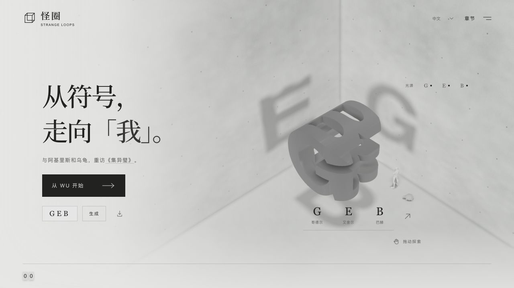
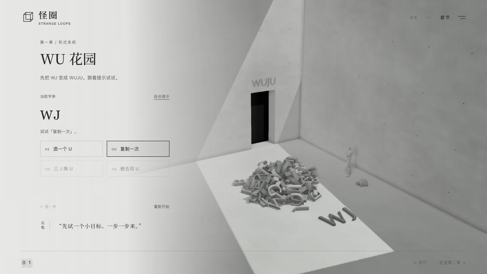
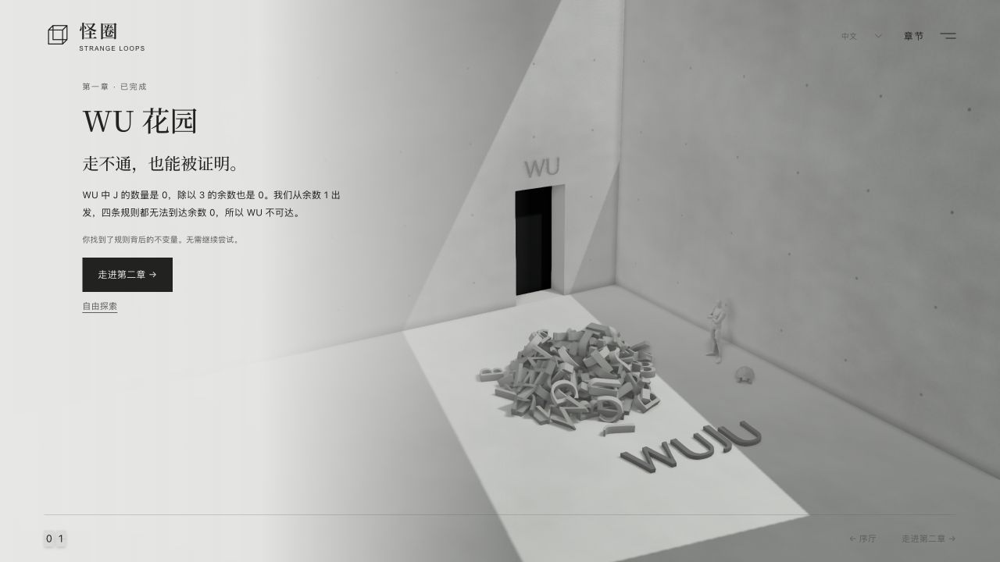
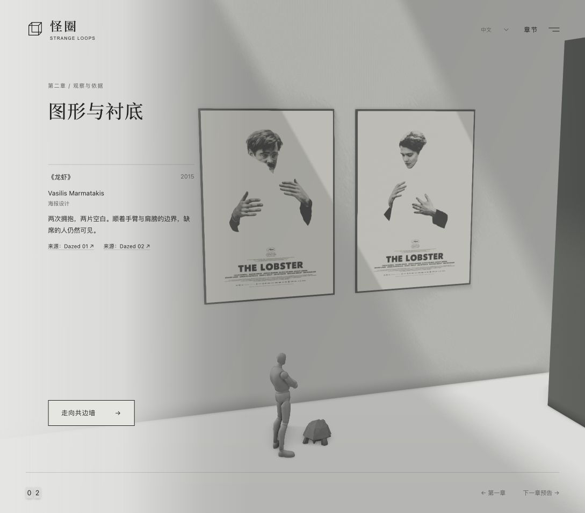
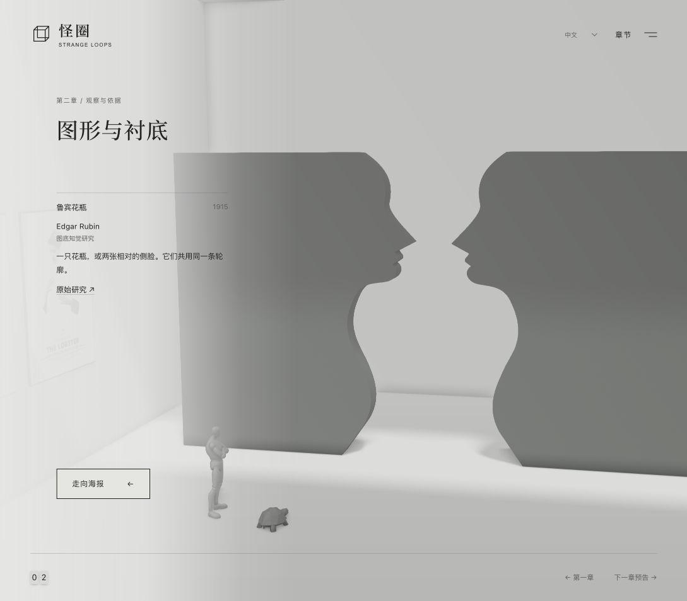
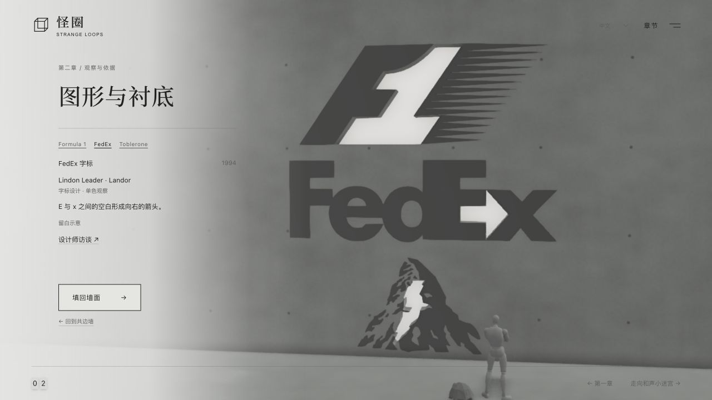
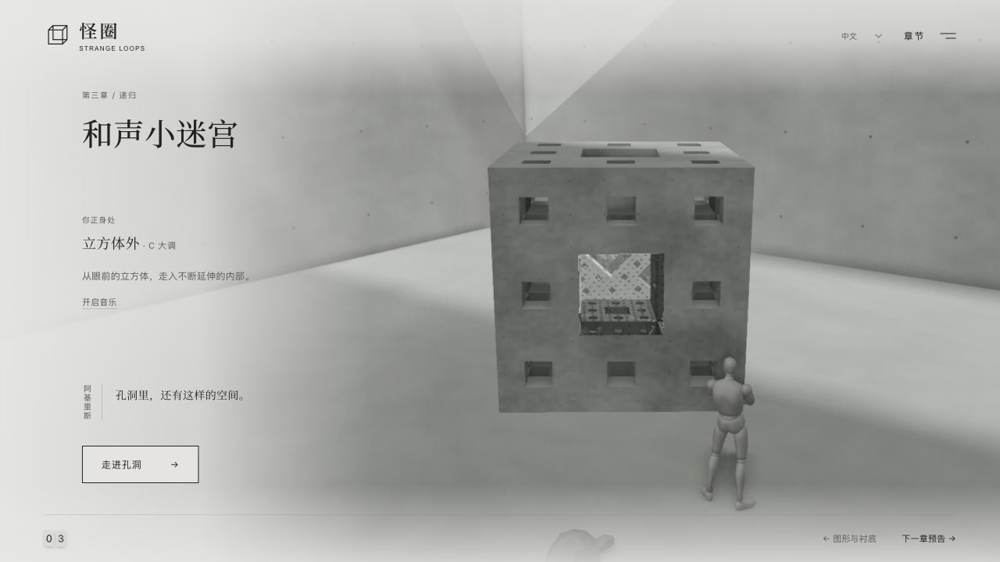
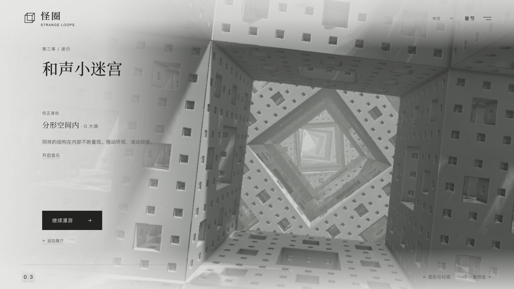

# 怪圈 · Strange Loops

简体中文 | [English](README.en.md)

代码许可：[MIT](LICENSE) · [素材许可范围](LICENSING.md) · [参与贡献](CONTRIBUTING.md)

与阿基里斯和乌龟一起，在三维空间中重访《哥德尔、艾舍尔、巴赫：集异璧之大成》。从同一件雕塑的三种投影，走到符号改写与图底互换，用观察和操作理解书中的线索。展厅对白与说明为原创致敬，中文术语参考商务印书馆译本。

**[进入在线展厅](https://www.gallerymate.xyz/experiences/geb?lang=zh)** · [English](https://www.gallerymate.xyz/experiences/geb?lang=en) · [试试自定义雕塑 CAT](https://www.gallerymate.xyz/experiences/geb?lang=zh&s=CAT)

当前代码包含序厅、第一章、第二章和第三章。支持中文、英文、日文、韩文、法文、德文和西班牙文；切换语言会保留游览与解谜进度。第四章至第七章仍在制作，章节地图中置灰显示。第三章尚待同步到 GM，在线站点沿用已部署版本。

截图更新于 2026-10-27，基于 `cf25386` 与本次 FedEx 展项更新，统一采用 1280 × 720 桌面视口。

## 序厅：三重投影

一件雕塑在三束互相垂直的光下投出 G、E、B。拖动观察、切换字母视角，或分别开关光源。也可以输入任意三个大写拉丁字母，在浏览器里生成新的交集雕塑，并下载当前模型的 STL。



## 第一章：WU 花园

先跟随提示，用四次改写把 WJ 变为 WUJU，再观察 J 的数量、三个一组的余数和四条规则的影响，发现为什么 WU 不可达。理解不变量后即可完成本章，无需一直试下去；也可以继续自由探索。

规则一键应用，多处匹配时使用最左一处；支持提示、退一步与重新开始。内部使用原版 MIU 系统，中文界面显示 WJU，其余语言显示 MIU。存档恢复时会逐步验证推导，三维字母与真实改写同步。





## 第二章：图形与衬底

两位同行者穿过 WU／MU 出口，进入天光美术馆。先看并置的两款《龙虾》海报，沿拥抱的边界寻找缺席的人；再走向 Rubin 共边墙，在两张侧脸之间看见花瓶。继续看右侧的负空间墙：Formula 1 的 1、FedEx 的箭头、Toblerone 山中的熊是三处真实镂空。标志不动；「看留白」抽出填块，光从孔洞透出，再填回墙面。页面展签介绍作者、年份与来源，可以往返观察。







角色穿门时慢跑，展品之间使用 Formal 步态；步频跟随实际位移，镜头先聚焦展品并恢复阅读，角色随后到位。第二章保留观察与展签，不设置数字墙、数学问答或完成徽标。

## 第三章：和声小迷宫

穿过 Rubin 共边墙的真实空隙，来到一只门格海绵立方体前。中央孔洞显现更广阔的内部；走进去后，同样的结构在弯曲、倾斜的空间中不断重现。支持持续漫游、暂停环视、滚动探索和随时返回展厅，角色留在外部观察。





孔洞窗口与内部共用固定像素和射线预算，并在加载时预编译；约 8 秒进入，角色留在外侧，暂停时复用画面；沿途不增加网格或保存无限距离。原创 Web Audio 乐句默认关闭，点击开启后随进入和返回从 C 转到 G，再接续 C。

保留七语言、独立存档、Esc 导航、减弱动态的「向前一步」和无 WebGL 图解。旧版两层存档迁移为外部／内部状态；刷新后内部保持静止。见[第三章制作计划](outputs/strange-loop/docs/chapter-03-plan.md)。

## 画面与交互

- Three.js PBR 材质、实时光源投影、PCSS 柔光阴影、GTAO 与 FXAA；黑白纸灰配色，无景深或循环背景音频；第三章音乐由操作触发。
- 第一章的字母堆使用 cannon-es 在 Web Worker 中模拟重力与碰撞；改写字母单独呈现。
- 角色骨骼待机、转头和行进；页脚以翻牌数字标记章节，地图提供已开放空间的导航。
- 自托管中文字体、键盘操作和系统减弱动态支持；WebGL 不可用时仍可操作第一章规则、浏览第二章的 SVG 与 HTML 展项。

## 本地预览

仓库包含构建后的网页和模型，无需安装依赖即可预览：

```sh
cd outputs/strange-loop
python3 -m http.server 4173
```

打开 [中文预览](http://localhost:4173/?lang=zh) 或 [English](http://localhost:4173/?lang=en)。需通过 HTTP 访问。

修改源码时：

```sh
cd outputs/strange-loop
npm ci
npm test
npm run build
npm start
```

`npm run build` 会更新网页主脚本、翻牌样式及两个 Worker；修改后刷新浏览器。详细实现见[网页文档](outputs/strange-loop/README.md)。

检查人物动作时，运行 `npm run preview:build`，在同一本地服务器打开 `/clip-preview.html?lang=zh`。可暂停、拖动动作相位，检查走跑切换、速度混合与头颈注视；该开发页不随展厅发布。详见[角色动作说明](outputs/strange-loop/docs/companion-motion.md)。

## 发布到 Gallery Mate

在已提交的干净版本中运行：

```sh
cd outputs/strange-loop
npm run release
```

生成的 `dist/experiences/geb/` 包含七语言 HTML、运行资源、素材声明，以及记录来源提交和文件 SHA-256 的 `release.json`。源仓库 CI 会验证并上传发布包；更新官网时，将该包导入 GM 仓库，合并同步 PR 后由 GM 的 ECS 流程发布。

发布流程见[官网部署说明](outputs/strange-loop/docs/deploy-gallerymate.md)，第二章行为与检查记录见[本地验收文档](outputs/strange-loop/docs/chapter-02-verification.md)。

## 素材与项目结构

- **阿基里斯模型**：POLLO28 的 [STYLE Fortnite-creative-mannequin](https://sketchfab.com/3d-models/style-fortnite-creative-mannequin-5da12762b03a40078e21e51a1e185e8c)，[CC BY 4.0](https://creativecommons.org/licenses/by/4.0/)，经减面、材质与动作适配。
- **角色动作**：Quaternius [Universal Animation Library](https://quaternius.com/packs/universalanimationlibrary.html) 的 `Walk_Formal_Loop`、自然摆臂 `Walk_Loop` 与 `Jog_Fwd_Loop`，CC0，经 Blender 重定向；保留原模型的抱臂待机与转头。
- **乌龟**：由用户使用 Tripo 生成，经 Blender 清理、减面与骨骼绑定。
- **展品**：《龙虾》海报由 Vasilis Marmatakis 设计，逐幅来源见展签与[素材声明](THIRD_PARTY_NOTICES.md)；Rubin 墙体使用原创轮廓，标注研究出处。项目未包含原书全文、封面扫描或埃舍尔原画。

`outputs/strange-loop/` 保存网页源码、测试与运行资源；`outputs/characters/` 保存 Blender 工程、重定向脚本、源模型和动画预览，详见[角色文档](outputs/characters/README.md)。[PRODUCT.md](PRODUCT.md) 与 [DESIGN.md](DESIGN.md) 记录产品方向和设计约定。全部依赖、字体及素材许可见 [THIRD_PARTY_NOTICES.md](THIRD_PARTY_NOTICES.md)。

## 贡献与许可

欢迎贡献问题修复、数学与叙事改进、翻译、无障碍和新章节。开始前请阅读[贡献指南](CONTRIBUTING.md)（[English](CONTRIBUTING.en.md)）。原创代码与技术文档采用 [MIT](LICENSE)，允许商用和闭源复用，保留版权及许可声明。

模型、字体、海报及含这些素材的截图遵循各自条款；项目 MIT 不统一授权这些素材。乌龟已记录为 Tripo 付费方案、私有生成，模型未另行授予开放复用许可。完整边界见 [LICENSING.md](LICENSING.md)，作者与上游许可见 [THIRD_PARTY_NOTICES.md](THIRD_PARTY_NOTICES.md)。
