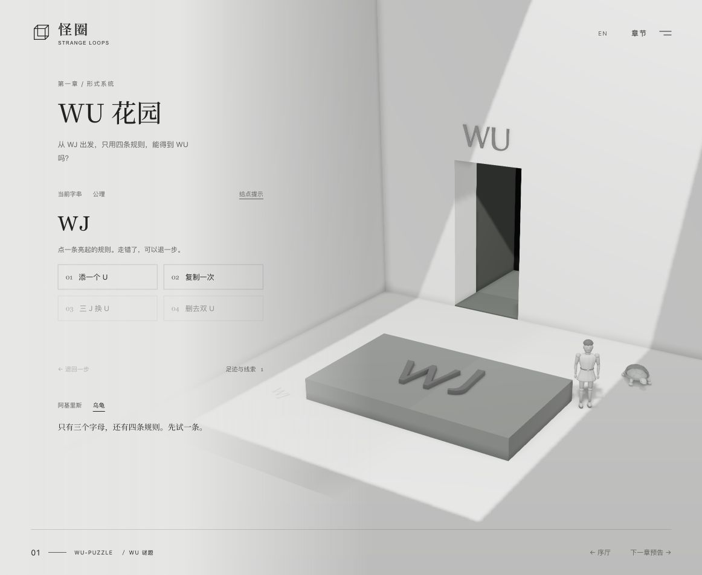
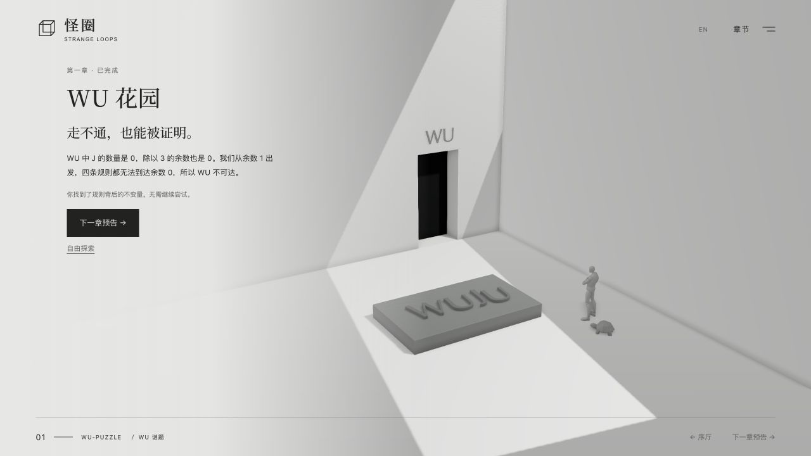

# 怪圈 · Strange Loops

简体中文 | [English](README.en.md)

以《哥德尔、艾舍尔、巴赫：集异璧之大成》为灵感的中英文可交互叙事展。序厅从一件三维雕塑的 G、E、B 投影出发，第一章「WU 花园」让你亲手改写符号。阿基里斯与乌龟在旁漫游、停留并与你交谈。

序厅使用 Three.js PBR 材质、PCSS 柔光阴影与 GTAO，支持拖动观察、三种字母视角、光源开关、自定义三字母雕塑生成（`?s=XYZ`）、当前雕塑 STL 本地下载、中英文切换和角色待机骨骼动画。文案为原创致敬；阿基里斯基于 POLLO28 的 CC BY 4.0 人偶模型，乌龟使用用户提供的 Tripo 生成网格，均经 Blender 优化与动画适配；详见[素材署名](THIRD_PARTY_NOTICES.md#achilles-mannequin)。


## 模型来源

- **阿基里斯**：采用 POLLO28 的 [STYLE Fortnite-creative-mannequin](https://sketchfab.com/3d-models/style-fortnite-creative-mannequin-5da12762b03a40078e21e51a1e185e8c)，许可为 [CC BY 4.0](https://creativecommons.org/licenses/by/4.0/)。本项目进行了减面、材质调整和动作适配。
- **乌龟**：由用户使用 **Tripo 生成**，随后在 Blender 中清理、减面、绑定骨骼并适配动画。

原始模型与可编辑工程均保留，详见[角色文档](outputs/characters/README.md)和[素材声明](THIRD_PARTY_NOTICES.md)。

## 本地预览

仓库已包含构建后的网页与模型，无需安装依赖即可预览：

```sh
cd outputs/strange-loop
python3 -m http.server 4173
```

打开 <http://localhost:4173>。需要 HTTP 服务，不能直接双击 HTML。

## 修改与构建

```sh
cd outputs/strange-loop
npm ci
npm test
npm run build
npm start
```

网页是静态页面，发布目录为 `outputs/strange-loop`。详细渲染、交互和文案说明见[网页 README](outputs/strange-loop/README.md)。

## 项目结构

- `outputs/strange-loop/`：网页源码、锁定依赖版本、构建脚本、已构建 JavaScript、雕塑及角色 GLB。
- `outputs/characters/`：Blender 可编辑工程、建模与动画生成脚本、渲染预览及[角色说明](outputs/characters/README.md)。
- `PRODUCT.md`、`DESIGN.md`：产品方向与已确认的设计规范。

Blender 角色工程包含骨骼、材质及 Idle / Walk / Look 动画。重建命令见角色说明。

## 当前范围

序厅与第一章可完整体验。WU / MU 花园先用四次点击完成小目标，再通过数 J、三个分组和检查四条规则发现不变量。选出 WU 不可达的正确理由后，本章即完成并保存，无需反复尝试；自由探索为可选项。四条原版规则一键应用，多处符合时默认改写最左侧；界面只保留提示、退一步和重新开始，不展示历史记录。三维字母同步变化，中英文切换、返回序厅和刷新会保留进度；无 WebGL 也能操作规则。第二章及后续章节尚未开放。

下一章节见[第二章制作计划](outputs/strange-loop/docs/chapter-02-plan.md)。漫游地图将第二章至第七章置灰，右侧保留章节主题。





项目未包含原书全文、封面扫描或艾舍尔作品图像。依赖及字体声明见 [THIRD_PARTY_NOTICES.md](THIRD_PARTY_NOTICES.md)。

部署说明见[发布到 Gallery Mate 官网](outputs/strange-loop/docs/deploy-gallerymate.md)。
