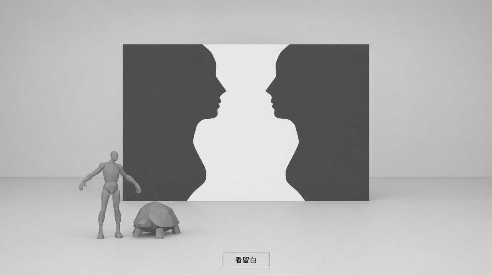
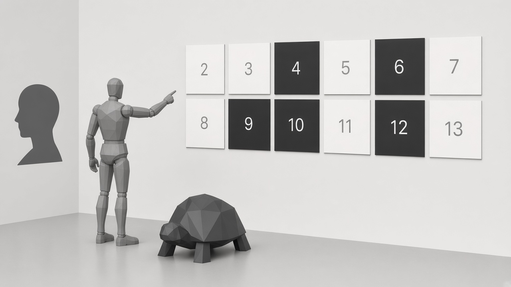
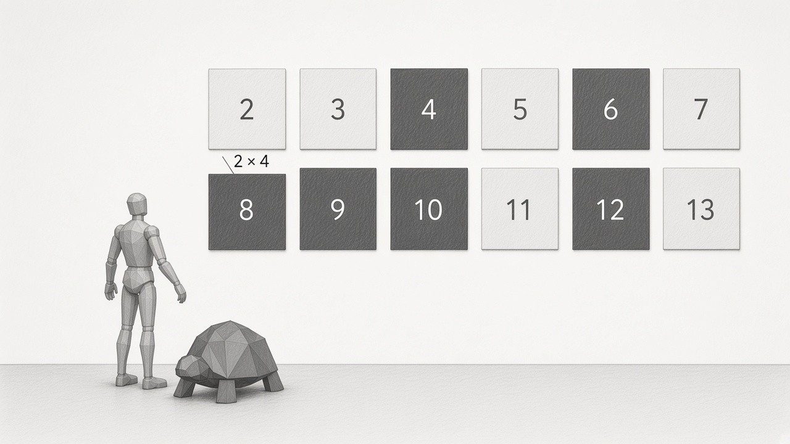
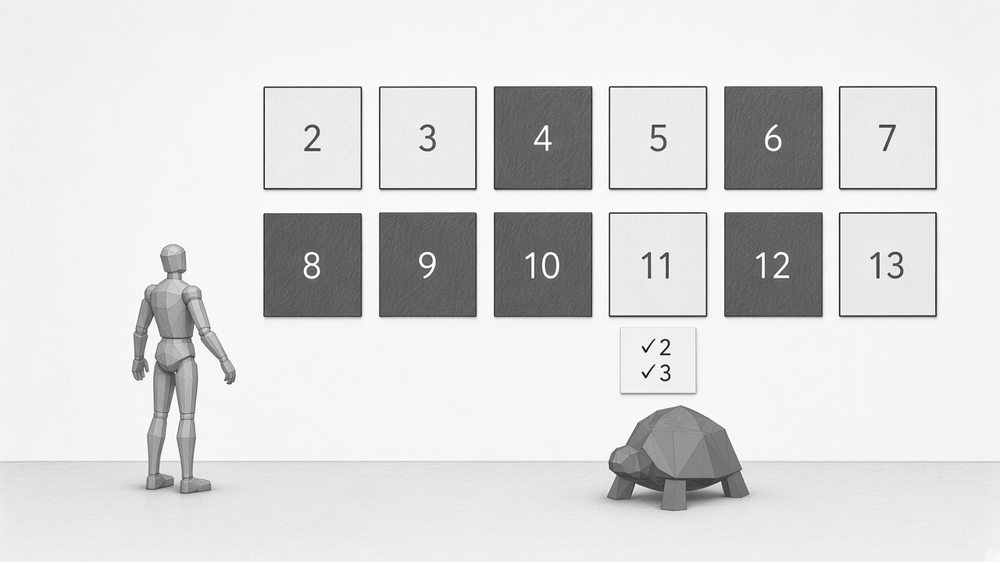

# 第二章制作计划：图形与衬底画廊

状态：已实现并完成本地验证，记录见 [实施与验收](chapter-02-verification.md)。下文保留叙事与验收要求；2026-10-21 用户进一步确认将 Rubin 轮廓融入建筑墙体，将《龙虾》海报挂在侧墙，并让两位同行者在展厅内行走。目标体验约 90–120 秒，按玩家操作推进，不自动限时跳段。

## 首版范围

一间画廊、一个 Rubin 花瓶式共边轮廓、一个数字展面、一条短流程。沿用现有阿基里斯与乌龟，不再增加人物或学习新的符号操作规则。主流程约 5 次点击（不含入章与可选帮助）；解释默认收起，没有必须等待的演出。章节完成以理解确认为准，不以观看时长或尝试次数为准。《龙虾》黑白海报作为可选的负空间延伸案例，不增加主流程步骤或完成条件。

交付物包括原创轮廓源 SVG、可操作的三维展面、对应的无 WebGL 图文流程、七语言文案、独立进度保存及验收记录。空间沿用用户认可的黑白灰展厅、真实斜向天光和展品侧下方的同行者。

## 本章要让玩家带走什么

第一章发现：没有找到 WU，并不是证明；不变量才给出了理由。

第二章接着问：当规则画出了“能生成的东西”，剩下的空白是否也已经被我们理解？玩家先体验同一条边界的两种读法，再通过符号与数量的对应进入数字展面，发现“尚未生成”与“确定无法生成”需要不同的证据。最后，曾被忽略的数字获得自己的判定依据和轮廓，从背景成为被确认的对象。

故事线：**看见空白 → 猜测空白的含义 → 用新证据修正猜测 → 主动判断，让留白成为图形。** 玩家应能说出：“还没出现，不能说明永远不会出现；要判断它属于哪一类，需要一个有依据的方法。”

## 与原书、中文版的对应

- 展览的第二章对应原书第三章 Figure and Ground，商务印书馆译名为“图形与衬底”。展览七章为主题选编，不与原书章号一一对应。
- 原书第二章“数学中的意义与形式”讨论符号形式与解释之间的对应。用一个短过门承接这条线索：同一组短划既可看成符号，也可按分组读成数量关系。这个乘法展陈是我们的改编，不冒充原书第二章的 pq 系统，也不把任意换标签当作理解意义。
- 视觉错觉是入口。核心仍是形式系统中被生成的集合及其补集，而非仅仅切换黑白配色。
- 原书第三章以 tq 系统表达乘法、刻画合数，并质疑能否直接把“合数串不是定理”作为生成素数串的规则条件：这个条件本身需要判断方法。原书随后给出正面刻画素数的规则。首版保留这个问题，用有限数字和试除演示代替完整 tq 操作，避免再让玩家学习一套改写规则。
- 器皿／侧脸屏风、先留白后生成的 8、检查 11 的按钮和判定后的空间轮廓均为展览改编。素数检查呈现“为剩余部分寻找依据”的思路，不复刻原书的素数形式系统。
- 对白全部原创。首版自行绘制几何轮廓，不直接使用艾舍尔原作扫描。

核对来源：[商务印书馆目录](https://www.cp.com.cn/book/7-100-01323-2_41.html)；[MIT OpenCourseWare 原课程讲义：Chapter III, Figure and Ground（公开镜像 PDF）](https://mitocw.ups.edu.ec/high-school/humanities-and-social-sciences/godel-escher-bach/lecture-notes/MITHFH_geb_v3_9.pdf)。出版社目录用于中文章节名称，课程讲义用于数学主题核对；下面的场景、机制与对白为本展方案。课程讲义仅辅助核对，不把本展的器皿／侧脸造型或数字流程称为原书中的场景。

## 一条短路线

| 段落 | 玩家操作 | 看到的变化 | 理解点 |
| --- | --- | --- | --- |
| 进入 | 从第一章继续，或由地图进入 | 字母堆与操作字串退场，人物走向白色屏风；门洞和天光延续 | 从操作符号转向观察边界 |
| 换一种看法 | 点击“看留白” | 先辨认深灰的两张侧脸，再注意到中间留白中的器皿 | 图形与衬底共享边界 |
| 符号获得意义 | 点击“看看规则”，进入数字展面 | 两组各三枚短划与总共六枚短划对应，旁边浮现 2 × 3 = 6；随后保留为第一批合数证据 | 符号能被解释，是因为关系对应得上 |
| 空白的证据 | 点击“再生成一批” | 展面自动提示尚未列出的 8，随后由 2 × 4 点亮 | 还没出现，不代表不会出现 |
| 有限判断 | 点击“检查 11” | 展面自动聚焦 11，检查 2、3 后确认它为素数；11 获得独立的细轮廓和证据标记 | 留白也可以通过另一种方法获得确定依据 |
| 收束 | 回答一个简短问题 | 8 的乘法证据与 11 的判定标记并置；标记本章完成，显示第三章预告 | 区分“未生成”和“已证明不属于” |

每段只提供一个主要操作。8 和 11 由流程自动聚焦，不要求先点中小数字才能继续；短划解释随进入展面呈现，不新增规则教学或确认弹窗。没有倒计时、失败惩罚、历史列表或隐藏点击点。识别不出错觉时可直接显示轮廓说明，继续后续段落。

## 场景分镜与节奏

| 镜头 | 参考时长 | 构图与灯光 | 操作与反馈 |
| --- | --- | --- | --- |
| 过门 | 5 秒 | 第一章字母堆与操作字串退场，沿原出口方向衔接白色画廊；保留门的比例、斜向天光与人物尺度 | 进入后焦点落在章节标题；减少动态时直接到达 |
| 共边 | 15–20 秒 | 大幅薄屏风近正视，深灰双侧脸之间留出器皿；天光照出厚度，避免阴影覆盖关键轮廓 | “看留白”只转移观察重点；细轮廓线提示两种读法，完成后可继续 |
| 符号解释 | 15–20 秒 | 镜头转向相邻数字墙，屏风仍留在画面边缘；两组各三枚短划对应六枚总量 | “看看规则”触发过门，显示 2 × 3 = 6，保留为合数证据；无需额外确认 |
| 尚未生成 | 20–25 秒 | 数字墙展示 2–12，屏风仍在同一空间；自动聚焦 8 | 8 初始显示“尚未列出”；点击“再生成一批”后以短动画呈现 2 × 4 = 8，留白转为已有证据 |
| 有限检查 | 20–25 秒 | 展面突出 11，保留 8 的乘法证据作对照；两个角色转向展面 | 点“检查 11”，依次显示除以 2、3 均不能整除，随后显现细轮廓并标记“已验证素数”；可立即显示全部结果 |
| 收束 | 15–25 秒 | 展面保留两条证据，左侧只呈现一个理解问题 | 答对后保存完成状态，提供自由观察、返回与第三章预告；不要求继续生成 |

这些时长用于控制内容量，不作为推进计时器。场景占主要视觉面积，引导区始终只呈现本步一句引导和一个主操作，首个屏风镜头将按钮置于展品下方。3D 中的数字与 HTML 控件指向同一逻辑操作；不要求用户点击细小网格。

## 空间与视觉

延续黑白纸灰、PBR、AO、真实天光和小比例同行者。首版仅增加一面薄屏风与一处数字展面，不增加楼梯、迷宫或复杂园林。

主场景确定采用 Rubin 花瓶的图底原理，自行绘制“花瓶／双侧脸”的共边轮廓，不描摹某一张现成图片。先用 SVG 验证两种形状都容易认出，再挤出成低面数几何。两块深灰侧面之间的留白形成花瓶，白色后墙提供衬底。按钮只改变轮廓提示与叙述焦点，不增删几何，不把空隙突然实体化。建筑和物体的阴影继续来自场景灯光。

识别镜头保留一个可一键恢复的正视观察位，拖动范围受限，避免大角度透视破坏共边关系。提示线只作阅读辅助，不冒充实体投影；不增加贴在墙上的假阴影、景深或音频控件。数字证据使用文字及下划线／轮廓区别状态，不单靠灰度变化。

数字展面展示有限范围 2–12，避免把 1 错标为素数或合数。用三种明确状态区分证据：深灰实面表示“已生成的合数”；未标记的留白表示“尚未分类”；细轮廓加“已验证素数”标记表示完成了独立判定。每种状态配可访问的文本，不能只靠深浅区分。“未被合数生成器列出”不直接等于“素数”。

过门中的短划与数量关系直接放在这处 3D 展面上，不另开全屏课件。两组各三枚短划保留清楚的分组，同时显示总量六；数字和乘法记号作为同一关系的解释出现。短叙述强调对应关系，不要求玩家记住 t、q 或操作第二套符号系统。解释完成后，6 成为第一批合数之一，避免演示提前生成关键反例 8。

第一批仅显示 4 = 2 × 2、6 = 2 × 3、9 = 3 × 3；下一批显式加入 8 = 2 × 4。这是一个有意只走了部分步骤的生成过程，不能把这两批误称为该范围的完整合数列表。检查 11 使用独立、会结束的试除过程，显示检查 2、3 的结果；“为什么足够”可展开查看。

检查 11 完成后，数字周围的细轮廓逐渐显现，证据标记与数字留在场景内。它保持在原位置，不被移入合数区域，也不被表现为合数生成器的下一次输出。这个变化呼应屏风：先前只被当作背景的地方，现在成为有依据的观察对象。屏风本身的几何和空隙始终不变；减少动态模式直接呈现结果，静态后备页面以相同标记和文字表达。

面板里的“生成进度”与“数学分类”分别存储：11 的素数结论来自试除证据，不能由它在生成批次里缺席推断。2、3、5、7 等未选数字仍显示“尚未分类”，首版不要求完成整张数字表。

人物停在展品侧下方，初始靠屏风左前侧，进入数字段后转向相邻墙面，阿基里斯先认形、提出猜测，乌龟引导观察。两人每段最多各一句回应，不重复播报。移动端按“短引导 → 场景 → 当前操作”排列，所有操作可用按钮完成。

## 墙上延伸展品：《龙虾》的负空间海报

按用户 2026-10-21 的新要求，Rubin 共边轮廓成为具有厚度的两片墙体，花瓶部分保持为空。原来的可选外链案例改为侧墙上的两款《龙虾》（The Lobster，2015）黑白拥抱海报，设计者 Vasilis Marmatakis。海报保留完整画幅，来自用户在 [PR #5 评论](https://github.com/xiaoiver/strange-loops/pull/5#issuecomment-6313129108)指定的 Dazed 两款官方版本；作品与设计者信息见 [Dazed 设计师访谈](https://origin.dazeddigital.com/film-tv/article/42750/1/yorgos-lanthimos-posters-the-favourite-lobster-vasilis-marmatakis-interview)。来源与使用记录见仓库 `THIRD_PARTY_NOTICES.md`。

点击海报或低强调的作品标题可转向侧墙，阅读原创短评和署名来源；再次点击或 Esc 返回原观察位。打开或跳过作品均不改变数学证据和完成条件。运行时从本地加载图片，不热链，也不依赖外部网站可用性。海报不是本展原创或公版素材，不纳入项目代码或原创素材的再许可范围。

原创短评：画面中的人正拥抱着一片空白。但顺着手臂和肩膀的轮廓，你仍能辨认出另一个人。这里，留白让“缺席”也有了形状。

Rubin 轮廓提供两种读法，海报的空白承载叙事信息；两者均不替代数学证明。空间取意于安静的天光美术馆，不复制某座具体建筑，不标称为安藤忠雄作品。

## 概念图参考与落地取舍

以下五张图由用户提供，按对话中的编号原样保存。它们用于确认构图、展品尺度和叙事关系，不是已经实现的页面，也不作为运行时背景贴图。整体空间方向为：**先面对一件看法会变化的展品，再走近一面证据会增加的墙。**

| 概念图 | 采用的方向 | 实现时调整 |
| --- | --- | --- |
| 图 5：横屏共边屏风 | 入口主构图：大幅屏风、小比例同行者、展品下方一个“看留白”按钮 | 用有薄厚和真实阴影的几何展品；器皿是两侧轮廓之间的留白，切换时不实体化 |
| 图 4：展厅转角 | 屏风与数字墙处于同一空间，转向数字墙时保留屏风的一角，角色随观察对象转向 | 不把屏风替换成独立侧脸装饰；复用现有角色动作，指向手势不是新动画的硬性要求 |
| 图 3：8 的乘法证据 | `2 × 4 = 8` 就近出现在数字牌旁，数字由留白变为深灰实面 | 初始只生成 4、6、9；下一批仅追加 8。10、12 在此流程中仍未分类，不照图提前染深 |
| 图 2：11 的检查 | 检查依据留在 11 附近，角色把视线引向正在判断的对象 | 不使用单独的“✓2、✓3”，以免误读为可以整除；显示“不能被 2、3 整除”，完成后才加细轮廓及“已验证素数” |
| 图 1：竖屏共边屏风 | 手机布局参考：展品在上，角色在下，主操作靠底部 | 重新适配轮廓比例与取景，不直接把横屏图拉长；底部按钮留足安全区，角色不得遮住识别轮廓 |

概念图中的数字范围是 2–13；首版仍按计划使用 2–12，不为凑齐两行六格引入额外数字或空白“谜题格”。数字牌是固定顺序的展陈，依据屏幕调整排布；未分类数字保留可读数字和中性表面，不能把所有浅色牌都暗示为素数。

角色继续采用现有 GLB、自然站姿与已有 Walk / Look / Idle 动作，不照搬图中的关节人偶造型或张臂姿势。保留展品与角色的尺度差和侧下方站位。墙面、屏风和数字牌采用平滑纸灰材质，减弱图中的颗粒纹理；斜向天光、AO 与接触阴影沿用已认可的场景风格。

两处展品在空间中持续存在。点击“看看规则”时平滑转向相邻数字墙并略微靠近，保留视觉连续性；相机稳定后再强调短划与数字关系。减少动态模式直接切到目标观察位，不能要求观看移动才能解锁操作。第一章切入、返回和快速重复导航都必须同步处理物体可见性及阴影，避免字母堆或角色阴影残留。

证据应出现在 3D 展面上，并提供同步的 HTML 文本供键盘、屏幕阅读器和无 WebGL 模式使用。界面只留当前引导与一个主操作；返回上一章、章节导航及下一章预告沿用 footer，避免另起一排导航按钮。可选帮助就地展开，不用遮盖上方操作的悬浮提示。

### 图 5：横屏入口主构图

### 图 4：同一展厅内转向数字墙

### 图 3：生成 8 的证据

### 图 2：检查 11 的证据

### 图 1：手机端构图参考

## 原创文案草案与语言覆盖

下表用中英文对照确定语义。正式开放时同时覆盖现有七种语言：中文、英文、日文、韩文、法文、德文、西班牙文，包括对白、证据状态、按钮、说明和可访问标签。语言切换保持当前步骤与判定结果。

| 场合 | 中文 | English |
| --- | --- | --- |
| 章节引导 | 你看见的空白，也有形状。 | The space you overlook has a shape. |
| 视觉操作 | 看留白 | Look at the ground |
| 阿基里斯 | 两张脸，正看着对方。 | Two faces, looking at each other. |
| 乌龟 | 看看它们之间。器皿的轮廓一直在那里。 | Look between them. The vessel's outline was there all along. |
| 过门操作 | 看看规则 | Look at the rules |
| 过门解释 | 两组，每组三枚。换成数字，这个关系仍然成立。 | Two groups of three. Written as numbers, the relationship still holds. |
| 阿基里斯的猜测 | 剩下没出现的，就是素数吧？ | So the ones that haven't appeared must be prime? |
| 数字提示 | 8 还没出现。现在能下结论吗？ | 8 has not appeared yet. Can we conclude anything? |
| 新证据 | 2 × 4 = 8。刚才的留白也能被生成。 | 2 × 4 = 8. The blank can be generated too. |
| 有限检查 | 检查 11 | Check 11 |
| 检查结果 | 2 和 3 都不能整除 11；必要的因数检查已完成。11 是素数。 | Neither 2 nor 3 divides 11; all necessary divisor checks are complete. 11 is prime. |
| 留白成为图形 | 这次，我们不只是在等它出现。我们有了判断的依据。 | This time, we did more than wait for it to appear. We have a reason for our conclusion. |
| 状态区分 | 尚未分类 / 已有合数证据 / 已验证素数 | Not classified yet / Composite evidence found / Verified prime |
| 轮廓帮助 | 没看出来？显示轮廓 | Need a hint? Show the outlines |
| 第一章过门 | 规则告诉我们什么能出现。没有出现的呢？ | Rules tell us what can appear. What about what has not? |
| 理解确认 | 8 刚才为什么还是留白？ | Why was 8 blank earlier? |
| 正确理由 | 它还没被列出。 | It had not been listed yet. |
| 错误理由 | 留白就说明它是素数。 | Being blank meant it was prime. |
| 完成 | 第二章 · 已完成 | CHAPTER TWO · COMPLETE |
| 收束 | 没看见，是观察；不可能，还需要理由。 | Not seeing it is an observation. Calling it impossible requires a reason. |

## 完成条件与数学边界

1. 看过两种共边读法，或主动查看轮廓说明。
2. 看过短划分组与乘法数量关系的对应。
3. 见过 8 从“尚未列出”变成有生成证据的合数。
4. 看过 11 的有限判定依据及其独立轮廓标记。
5. 正确区分“未列出”与“已确定不属于”。选错只补充解释，读过解释后可重新选择，不重置体验。

完成后保存状态并收起教学操作，可选择自由观察或下一章预告。返回、刷新、语言切换不取消完成记录。第一章完成作为推荐进入路径，不做硬性通关锁。

不要把本演示说成一般不可判定性的证明。素数与合数都能判定；有限窗口的留白也不自动代表无限集合的补集。试除说明明确：若 11 是合数，必有一个不大于 √11 的因数，因此检查 2、3 足够。不能暗示检查两个数对任意整数都足够。

可选“与原书的联系”说明承接更深的问题：能不断列出系统中的定理，并不保证存在一个对任意输入都结束、判断其是否为定理的方法。有些形式系统具有这种差异，但本章有限数字演示不证明它。首屏不引入“可枚举／可判定”等术语，也不能让视觉上的图底互换改变 MU 的不可达结论。

## 状态、返回与异常

流程状态为 `contour → meaning-bridge → pending-eight → generated-eight → checked-eleven → reflection → complete`。过门动画使用独立的导航状态，不能自行标记学习步骤完成。

- `contour`：完成两种读法的提示或主动展开轮廓说明后继续。没有图形识别测验。
- `meaning-bridge`：展示短划分组与 2 × 3 = 6 的对应；解释与展面稳定后进入 `pending-eight`，不依赖动画回调，减少动态时直接呈现。
- `pending-eight`：自动聚焦 8，主按钮直接生成下一批；不设置必须先选中数字的前置步骤。
- `generated-eight`：生成批次只追加一次，保留 `2 × 4` 证据；重复点击不增加动画队列或重复对白。
- `checked-eleven`：必须产生完整的有限检查记录。提供立即显示结果入口，避免动画或减少动态偏好阻断推进。
- `reflection`：错误答案就地解释，并保留另一个答案；正确答案才进入 `complete`。七种语言使用相同答案标识。
- `complete`：收起教学控件；自由观察不清除完成标记，第三章仍进入预告。

新存档键建议 `geb.figure-ground.v1`，保存阶段、批次标识、检查记录和完成标记，不保存 DOM 或 Three.js 对象。恢复时验证阶段所需证据；坏存档退回最后可确认步骤，不能仅凭 `complete: true` 跳过全部依据。读写失败时允许本次体验继续，返回后可重新进入。第一章 `geb.garden.v1` 保持兼容。

Esc 依次关闭帮助、章节地图，再退出本章；焦点回到对应触发按钮。普通返回保留本章阶段，不重置第一章推导。切换语言保留步骤与证据，不重放已结束的角色反应。场景进入失败时，同一份状态和证据驱动 HTML 流程，显示 SVG 轮廓及数字列表，不要求 WebGL 或模型加载成功。

## 素材与实现清单

| 素材或模块 | 制作方式 | 首版约束 |
| --- | --- | --- |
| 共边屏风 | 原创 SVG 轮廓，运行时挤出；源文件随仓库保存 | 先验证识别再制作厚度，单件约千级三角面，不新增纹理 |
| 《龙虾》延伸案例 | 本地海报、原创短评、设计者信息与来源链接 | 按最新要求挂在侧墙，署名、短评和来源可查看；不增加完成条件 |
| 数字展面 | 复用字体与现有 Three.js 材质，11 个数字 | 保留 HTML 等价入口，不重建整间场景 |
| 同行者 | 复用现有 GLB、Walk / Look / Idle | 每段至多一次观察反应，不新增自动抱臂触发链 |
| 空间与照明 | 复用白墙、地面、门洞与天光做局部调整 | 复用现有渲染器和阴影方案，离章恢复原场景状态 |
| 七语言文案 | `figure-ground-copy.js` 集中管理 | 无障碍名称、状态、错误和完成页均覆盖现有七种语言 |
| 数学与流程 | `figure-ground-system.js` 纯数据逻辑 | 生成记录与分类证据分开；UI 和 3D 共用一份状态 |

`figure-ground.js` 管理 DOM、焦点与交互；`figure-ground-scene.js` 管理几何、拾取和释放资源。显示层不重复实现试除或完成判定。把目前的 `inGarden` 分支收敛为明确的当前章节状态，保留过场锁，避免同时显示两章或快速重复进入。

运行时复用既有角色，新增本地海报文件与原创 SVG，不新增网络依赖。上述概念图仅作为仓库内制作参考，不进入发布包。沿用已合并的官网发布适配，新增中文文案后重新生成并核对本地字体子集，再构建发布包；生产更新仍需将验证后的快照同步到 GM 仓库。仅合并本计划不会发布或开放第二章。

## 实施顺序

- **P0：验证轮廓。** 先完成共边 SVG 和正视预览，确认桌面、手机都能认出器皿及双侧脸。此时再确定挤出厚度与摆位。
- **P1：静态空间。** 接入屏风、数字展面、短划分组、三种证据状态和已有角色，复用真实天光及阴影；与第一章往返时无漏光或场景残留。
- **P2：完整短流程。** 建立独立章节状态、符号解释过门、生成证据与试除逻辑，接入七语言叙述、理解确认、完成保存；11 的证据在场景内可见。
- **P3：衔接与开放。** 串接第一章完成入口、章节地图、返回、Esc、减少动态与 WebGL 失败路径。通过验收后，才将地图第二章改为开放。

按 P0–P3 顺序实现。P0 若不能同时清楚识别两种读法，先修轮廓与正视构图，不能靠增加说明文字掩盖。P2 完整流程可以先在无 3D 的 HTML 中走通，再联动三维反馈；P3 才修改第一章的“下一章预告”入口与地图可用状态。地图只去掉第二章的置灰，第三至第七章继续置灰，右侧保留原主题文案，不加“未开放”字样。

## 验收

- 同一轮廓的几何保持不变，切换提示可辨认两种读法。
- 短划分组准确对应 2 × 3 = 6，并延续为合数证据；过门不要求学习额外改写规则。
- 初始留白的 8 后来确实由合法乘法生成；未列出状态不冒充“不可能”。
- 11 的检查覆盖所有必要因数并结束；判定后的轮廓与证据独立于合数生成结果。未分类数字不随之自动标为素数；1 不进入素数／合数二选一。
- 每段只有一个主要操作，8、11 无需精确点选；场景中的证据在非 3D 后备页面中同样可读。
- 屏风与数字墙属于同一空间；转场保留展品位置关系，减少动态时无需等待。角色和阴影没有跨章节残留。
- 竖屏轮廓不被拉伸，角色不遮挡识别边界，footer 和主操作不互相遮挡；检查 11 的结果没有含义不明的勾号。
- 主展品为自行绘制的 Rubin 花瓶式共边墙体；《龙虾》挂在侧墙。打开、关闭或跳过观赏均不改变学习证据与完成状态，关闭恢复焦点；海报本地加载，外链失败不阻断流程。
- 理解条件未满足时不显示完成；完成状态可以恢复，重复点击不重复触发过场。
- 七种语言、键盘、触屏、390 × 844、减少动态、无 WebGL 均有完整路径；语言切换保留步骤与证据状态。
- 序厅与第一章的光照、四条规则、推导保存和角色动画保持正常。

验收记录至少包含：

| 类别 | 必查用例 | 通过依据 |
| --- | --- | --- |
| 数学单测 | 部分生成中 8 缺席；下一批有合法乘法；11 检查 2、3；输入 1 不被判为素数 | 验证实际证据与停止条件，不只断言展示文案 |
| 流程单测 | 缺少观察／检查证据不可完成；答错不通关；坏存档降级；重复操作幂等 | 状态转移与恢复结果符合约束 |
| 桌面浏览器 | 第一章完成 → 第二章完成 → 返回 → 刷新恢复；逐步切换七种语言 | 保留两章各自进度，模型、字幕和按钮同步，无控制台错误 |
| 窄屏与键盘 | 390 × 844、横屏、Tab／Enter／Esc | 主操作可达、无横向溢出，焦点可见且不会落入隐藏章节 |
| 失败路径 | 无 WebGL、角色加载失败、减少动态、存储不可用 | 从入章到完成均可继续，数学结论不依赖动画回调 |
| 视觉与回归 | 两种轮廓正视截图、数字证据变化、七语言完成页；序厅和第一章往返 | 光束与阴影来自灯光，无场景残留、门洞漏光或重复角色动作 |

实现 PR 附上以上截图与实际验证结果，不把本计划中的目标写成已完成的功能或已通过的测试。

## English summary

Chapter two adapts the book's third chapter, Figure and Ground, with a short bridge from Meaning and Form. An independently drawn Rubin-vase contour introduces figure and ground; grouped marks then reveal a numerical relationship without teaching another rewrite system. A partial composite generator leaves 8 blank before generating it. A separate terminating check establishes that 11 is prime and gives it a visible outline and evidence marker in the 3D space, turning overlooked ground into an identified object. One short comprehension check completes the chapter. Each step has one primary action, and all seven existing languages are supported. The finite demonstration does not prove general undecidability, claim that primes are undecidable, or suggest that visual inversion changes formal derivability. An optional commentary on the black-and-white The Lobster poster extends the theme to narrative negative space, with two locally hosted official posters on the side wall and an on-page museum label, as requested on 21 October 2026. It adds no required step or completion condition. The implemented room is available from the chapter map; local verification is recorded in chapter-02-verification.md.

### 2026-10-21 展陈与动线补充

两款官方海报等高并置，保留完整原图与比例。页面上共享展签列出作品名、海报设计者 Vasilis Marmatakis、2015 年及 Dazed 来源，HTML 提供相同的可访问内容和分别对应两幅作品的链接；原创短评只解释留白。第一章进入第二章时，两位角色沿同一门洞依次穿过 WU（中文）／MU（其他语言）出口，以门内暗部衔接镜头，在第二章的侧墙入口继续走向共边墙。减弱动态与后备模式直接进入，数学目标与视觉出口互不设限。
