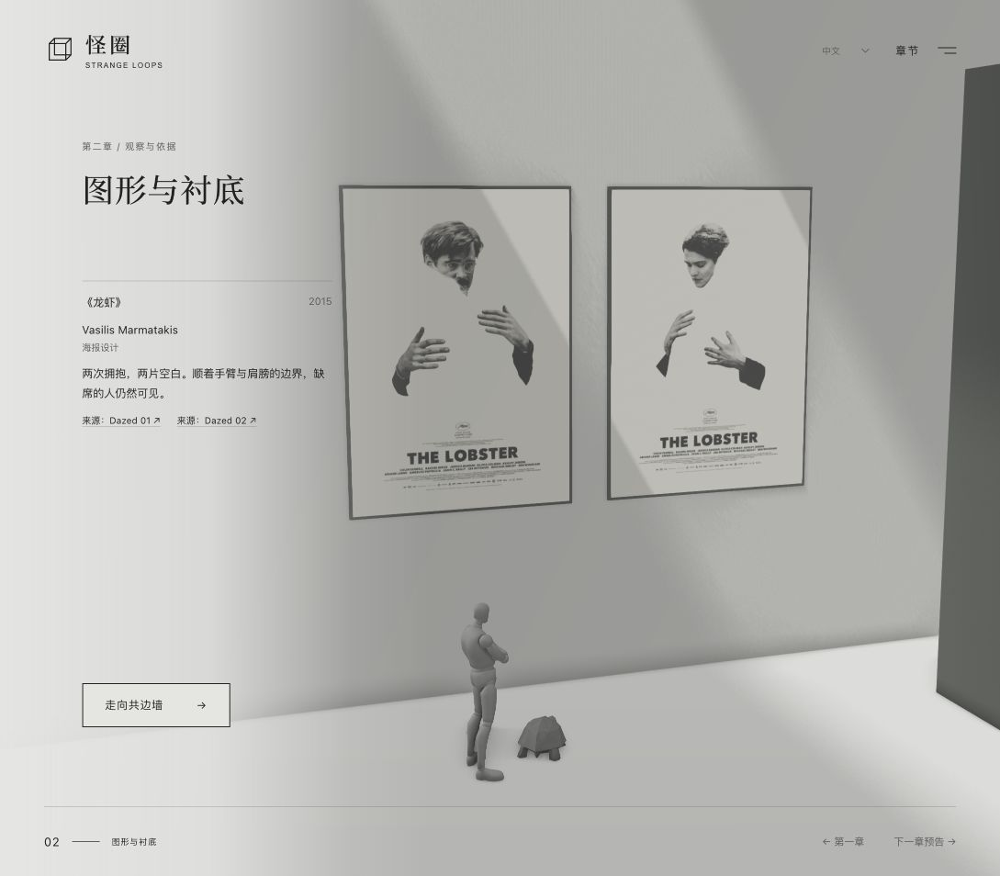

# 第二章实施与本地验收

2026-10-22：当前实现以《龙虾》双海报与 Rubin 共边墙为主线，移除数字墙。下方动作与步速调整保留为迭代记录，以本节和末尾相机先行说明为当前结果。

## 当前实现

- 两款用户指定的海报等高并置，保留完整原始画幅。页面展签包含设计者、年份、原创短评与逐幅来源。
- 角色经第一章 WU／MU 出口进入画廊，先停在海报前，再走向共边墙。
- 共边墙由两片原创侧脸轮廓墙体构成，中间保留真实花瓶空隙；页面介绍 Edgar Rubin、1915 年研究与来源。无辅助描边或墙面重复展签。
- 导航使用「走向共边墙」「看留白」「走向海报」。共边观察后可回看或打开下一章预告，不显示完成徽标或数学问题。
- 数字牌、算式、试除注记、数字墙相机、角色路线、HTML 数字列表、问答、图例及闲置翻译均移除。
- 状态内容升级至版本 4，仅保存两项观察记录。版本 1–3 的旧数字存档迁移到共边观察，刷新和切换语言不恢复已删除的展项。

- 当前步态为 Quaternius Formal 步行与 Jog 穿门慢跑；脚步按位移同步，修正膝盖反折与脚踝翻转。
- 第二章入口镜头短暂停留后约 1 秒聚焦当前展品，阅读不等待角色到位。乌龟解释性对白已移除，「走向海报」左置。
- 页脚保留数字并加入翻牌动画；地图第二章主副标题与页面统一，定位标记位于序号左侧，主题文字靠右。

## 自动验证

`npm test`：67 项通过，覆盖观察顺序、旧存档迁移、七语言、轮廓与署名、穿门路线、导出骨骼步态及脚部反转回归、相机提前完成与取消。`npm run release` 通过，发布包含 29 个文件。

`npm run build` 与 `npm run release` 校验发布包和官网子路径资源。这里只生成本地发布包，不部署官网。

## 浏览器验证

以下截图来自实际浏览器，使用当前页面，不是概念图。已检查旧数字墙存档回到共边观察，中英文切换保持观察对象，海报往返与预告／Esc 关闭正常。桌面和 390 × 844 手机视口均显示「走向海报 ←」，前往共边墙保持右箭头；手机无横向溢出，正常预览未观察到控制台错误。浏览器视口测试不等同于真实 iOS／Android 设备测试。

减弱动态及无 3D 后备沿用原有直接进入、SVG／HTML 路径。当前变更没有在真实系统偏好或实体手机上复测。素材来源见仓库 `THIRD_PARTY_NOTICES.md`。

第一章入口回归修复：补回第二章七语言 `enter` 文案，避免第一章页脚与完成页回退到旧的「下一章预告」。实际页面已检查中文「走进第二章 →」及英文「Enter chapter two →」，并在翻译检查中明确要求此跨章依赖字段。

序厅与第一章往返取消角色平移与 Walk 动画，停止未完成的原路径，保持当前站位后转向字母展品；直接进入、迟到的模型加载和减少动态分支使用同一位置保留选项。第二章返回第一章仍恢复花园站位，第一章到第二章的穿门路线保留。共边墙下方的重复说明及七语言字段、闲置样式已移除，页面展签保留。

补充返回修正：返回序厅复用原地转向选项；所有普通空间切换都检查实际位移，零距离不会启动 Walk。

实际浏览器复核序厅 → 第一章 → 序厅往返，返回后保持待机；第二章共边墙只有角色引导对白与展签，重复说明已消失，未观察到控制台错误。

## 阿基里斯慢走优化

Blender 保留原网格、骨架、抱臂 Idle 与 Look，重做 1.2 秒 Walk：支撑／抬脚分期、鞋底网格支点、双骨骼 IK、脚跟／脚尖滚动、骨盆重心变化与反向摆臂。另存 `outputs/characters/geb-companions-walk.blend`，原工程保留。

网页按实际位移同步动作时间，低速时与 Idle 混合；调整路线两端的加减速、稳定中段步速与转向跟随，减缓画廊及穿门节奏。延迟出发时保持待机，抵达后回到 Idle；序厅与第一章往返仍保留原地转向。

当前 `npm test` 共 60 项通过，新增三个动作检查：实际导出 GLB 的平脚支撑段滑动小于 0.002 模型单位、循环无明显接缝、变速与等待的动作时间准确，以及路线进度单调且没有速度尖峰。既有抱臂和重复手势测试继续通过。Blender 对每个烘焙帧检查整张蒙皮网格最低点，当前支撑面离地约 0.00012–0.00052 模型单位，无穿地。

网页正常加载新 GLB，海报与共边墙之间可行走，抵达后恢复待机，未观察到控制台错误。步态渲染预览来自同一 Blender 动作，独立于网页镜头，不代表实时浏览器录屏。尚未在实体手机上复测。

慢走穿门流程已实际走通：从第一章出门、切换画廊、从侧墙入口走到共边观察位，抵达后恢复语言、地图和章节按钮。此流程仍等两位角色抵达后再解锁，无控制台错误。

界面进一步精简：角色交谈按钮移除可见姓名标签及悬浮／焦点显示样式，保留七语言交谈 aria-label。序厅、第一章、第二章页脚统一只显示编号 00、01、02，去掉重复的名称；前后导航与章节标题保留。

### Footer split-flap chapter marker

The 00 / 01 / 02 footer uses locally bundled PQINA Flip 1.8.4 (MIT), with paper-grey panels and a 450ms flip. Initial render and locale-only updates keep their current values; only changed digits receive a new value. A single text number remains accessible, while the duplicated visual layers are aria-hidden. The reduced-motion branch renders static text and destroys the visual presenters; changing the preference rebuilds from the current chapter. Package attribution and full license are in THIRD_PARTY_NOTICES.md. The CSS bundle is included and content-hashed in the website release. All 60 existing tests and the release verification pass.

### Quaternius Walk_Loop trial (supersedes the procedural slow walk above)

Retargeted the supplied CC0 Standard library's Walk_Loop to the existing POLLO28 rig in Blender. Preserved mesh, skin, material, Idle, Look and tortoise; calibrated T/A reference poses, spine proportions, leg length and evaluated shoe contact. The root-motion reference provides 1.30 source units per 1.333s loop, converted to 1.93053 model units / 1.15832 scene units; the runtime clip contains no root advance. Forty-one baked samples retain at least 0.0009998 model units of sole clearance, with no unreachable-leg correction. Quaternius attribution, license and a one-clip source extract are saved alongside the editable new studio.

Startup/deceleration blends use a smooth speed ramp; finishing a distance-driven stop preserves the already-running Idle instead of fading it in again. Tests now exercise support toes through heel roll, every bone's loop seam, absence of root motion, sufficient travel for the longer stride, and the no-second-fade stop regression. All 61 tests pass, as do build/release verification. Browser inspection checked walking between the posters and shared-contour wall, return to the folded-arm idle, and no error/warning logs. The Blender close-up is `../../characters/mannequin-ual-walk-preview.gif` (not a browser recording); browser screenshots were separately captured during actual exhibit travel.

### Formal walk selected

At the user's request, the current runtime and editable `geb-companions-ual.blend` now use `Walk_Formal_Loop`. The original library source is preserved as `source/quaternius-walk-formal-loop.glb`; the prior normal-walk reference remains separate. The same retarget script fits both feet and derives stride from the formal clip's own root motion. The formal loop is 1.333s / 1.15832 scene units, with 41 baked samples and minimum sole clearance 0.00099986 model units. The mannequin, original Idle/Look, tortoise, routes and distance-driven stop handling remain unchanged.

Formal walk validation: all 61 tests and release checksum verification pass. The current Blender close-up GIF has been regenerated from the formal clip.

### Chapter passage jog

Added the CC0 Quaternius Jog_Fwd_Loop as a fourth Achilles clip. Its long running stride is adapted to 30% longitudinal excursion and 65% flight/pelvis lift, with distance calibrated from the retargeted support toe travel (2.87224 model / 1.72335 scene units per 0.933s cycle). Blender checks all 29 samples for shoe clearance and reachable legs. The source clip, license and new editable `geb-companions-jog.blend` are preserved.

Only the two chapter-one-to-two passage legs request Jog, at average 1.45 scene units/s. The tortoise keeps its own walk, at 1.10 units/s and proportional passage cadence; setSpace restores ordinary walk and cadence for exhibit visits. Existing door-crossing routes remain intact. With nominal garden positions the exit leg drops from 15.67s to 8.18s and entry from 13.76s to 7.20s (room cut excluded). Formal movement between exhibits, stationary vestibule/garden transitions, and reduced-motion handling remain unchanged. Map credits list both library clips in all seven languages.

Tests cover actual exported Jog support toes, every bone's loop seam, root drift, repeat playback across multiple loops, distance-driven pace/waits, and stop-to-Idle for both Walk and Jog. All 62 tests pass, including the four existing doorway route checks.

Browser validation of the new passage completed in English with the visitor’s custom sculpture preserved. The entering-gallery view visibly used the jogging pose, then restored the folded-arm idle and interactive chapter-two controls. No warning/error logs were reported. A separate Blender GIF provides the close-up jog preview. Build and release verification pass.

## Jog foot inversion correction

The compact-stride retarget projected the entire source thigh vector onto the shortened target leg axis. This could reverse the knee bend, despite passing the earlier planted-toe and loop checks. The Blender retarget now extracts the bend perpendicular to the source leg first, then projects that bend onto the target leg. The compact jog also limits anatomical foot pitch to −30°…75° and roll to ±12°, independently of mirrored bone axes.

The shipped GLB regression samples 225 phases per cycle (240 Hz), including between baked keys, at five Jog/Idle weights. It checks forward knee bend, upward sole direction, forward toe direction and bounded angular changes. The Blender near-camera 28-frame preview was regenerated. Existing Formal gait and support/loop/distance checks remain in place.

After this correction, all 63 tests pass; the production build and self-contained release verification also pass.

## Faster chapter passage

Passage-only speeds are now 1.80 scene units/s for Achilles and 1.40 for the tortoise (previously 1.45 / 1.10). Achilles cadence remains distance-driven; the tortoise passage cadence uses the same speed value as route duration. Nominal garden exit duration falls from 8.18s to 6.51s; desktop arrival at the contour falls from 8.65s to 6.88s, including the 0.4s tortoise stagger and excluding the room cut. All 13 locomotion and doorway route tests pass; production build succeeds.

A second timing adjustment raises passage speeds to 2.50 / 2.00 scene units/s. The nominal desktop transition now takes 9.04s to the posters or 9.83s to the shared contour, including the room cut and stagger. The same 13 locomotion and route checks and the production build pass.

## Camera-led gallery arrival

The gallery camera now spends 0.25s at the entrance and focuses the active exhibit over 0.8s. The camera completion unlocks reading and navigation; companions finish their unchanged entry routes independently, with no late completion callback to reset a newly selected exhibit. The existing poster-first tour and saved contour focus are preserved. Ordinary exhibit camera transitions remain 1.25s.

Four tests exercise the actual scene camera on desktop and mobile, early completion before either companion arrives, subsequent navigation, cancellation on leaving, and immediate reduced-motion arrival.

The ground-view tortoise explanation is removed in all seven languages, including live announcements; the Rubin exhibit label remains. The return-to-posters button aligns with the left text column on desktop, tablet and mobile. Relevant camera, chapter and translation checks (11) pass after this change; build succeeds.
