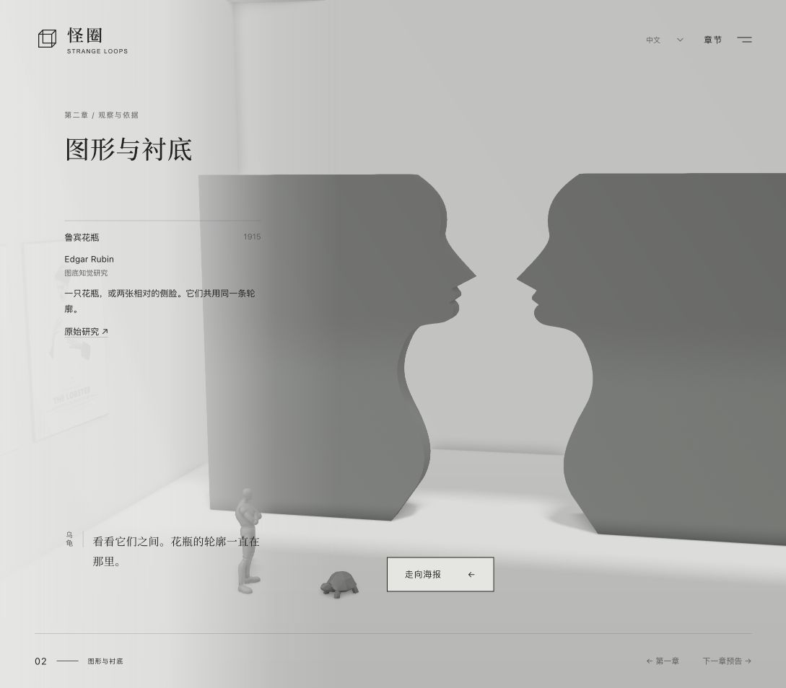
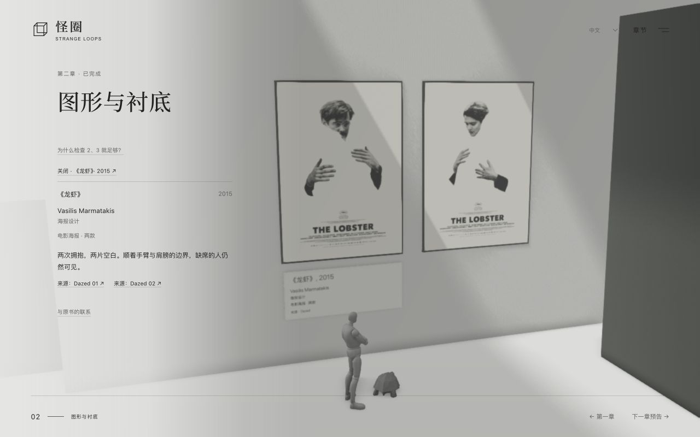
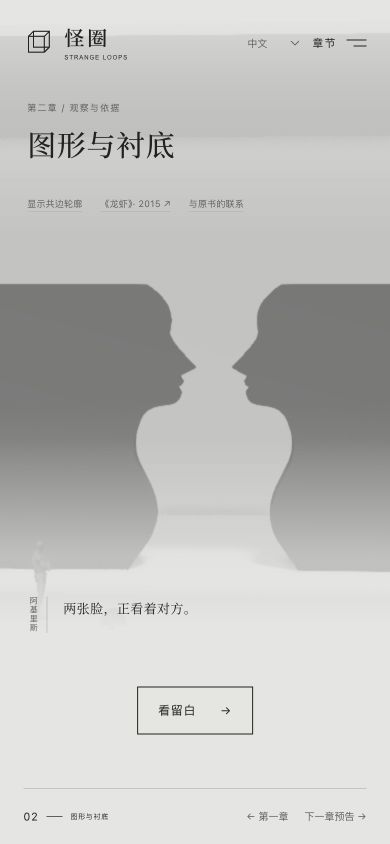
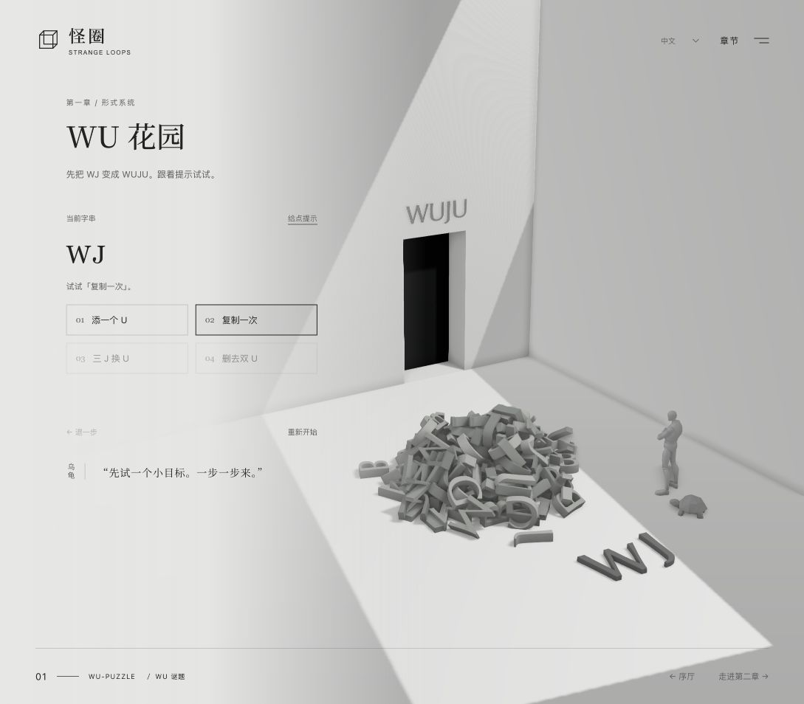
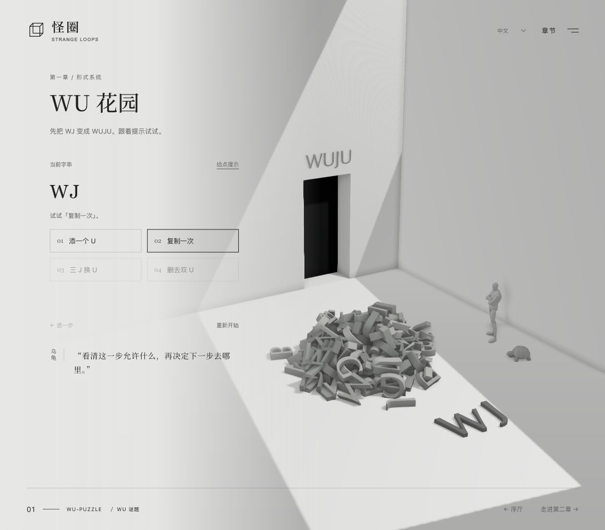

# 第二章实施与本地验收

2026-10-21 按用户最新反馈移除数字墙，当前只保留《龙虾》双海报和 Rubin 共边墙的观察动线。此前数字墙的实现与验收记录可在 Git 历史中查阅，不代表当前页面。

## 当前实现

- 两款用户指定的海报等高并置，保留完整原始画幅。页面展签包含设计者、年份、原创短评与逐幅来源。
- 角色经第一章 WU／MU 出口进入画廊，先停在海报前，再走向共边墙。
- 共边墙由两片原创侧脸轮廓墙体构成，中间保留真实花瓶空隙；页面介绍 Edgar Rubin、1915 年研究与来源。无辅助描边或墙面重复展签。
- 导航使用「走向共边墙」「看留白」「走向海报」。共边观察后可回看或打开下一章预告，不显示完成徽标或数学问题。
- 数字牌、算式、试除注记、数字墙相机、角色路线、HTML 数字列表、问答、图例及闲置翻译均移除。
- 状态内容升级至版本 4，仅保存两项观察记录。版本 1–3 的旧数字存档迁移到共边观察，刷新和切换语言不恢复已删除的展项。

## 自动验证

`npm test`：57 项通过。第二章保留观察顺序、重复输入、旧版迁移、七语言覆盖、SVG 与墙体轮廓一致性、研究署名检查；数字引擎被移除，其对应的三个测试不再运行。另有 4 项章节穿门路线检查。

`npm run build` 与 `npm run release` 校验发布包和官网子路径资源。这里只生成本地发布包，不部署官网。

## 浏览器验证

以下截图来自实际浏览器，使用当前页面，不是概念图。已检查旧数字墙存档回到共边观察，中英文切换保持观察对象，海报往返与预告／Esc 关闭正常。桌面和 390 × 844 手机视口均显示「走向海报 ←」，前往共边墙保持右箭头；手机无横向溢出，正常预览未观察到控制台错误。浏览器视口测试不等同于真实 iOS／Android 设备测试。

减弱动态及无 3D 后备沿用原有直接进入、SVG／HTML 路径。当前变更没有在真实系统偏好或实体手机上复测。素材来源见仓库 `THIRD_PARTY_NOTICES.md`。

第一章入口回归修复：补回第二章七语言 `enter` 文案，避免第一章页脚与完成页回退到旧的「下一章预告」。实际页面已检查中文「走进第二章 →」及英文「Enter chapter two →」，并在翻译检查中明确要求此跨章依赖字段。

序厅与第一章往返取消角色平移与 Walk 动画，停止未完成的原路径，保持当前站位后转向字母展品；直接进入、迟到的模型加载和减少动态分支使用同一位置保留选项。第二章返回第一章仍恢复花园站位，第一章到第二章的穿门路线保留。共边墙下方的重复说明及七语言字段、闲置样式已移除，页面展签保留。

补充返回修正：返回序厅复用原地转向选项；所有普通空间切换都检查实际位移，零距离不会启动 Walk。

实际浏览器复核序厅 → 第一章 → 序厅往返，返回后保持待机；第二章共边墙只有角色引导对白与展签，重复说明已消失，未观察到控制台错误。
