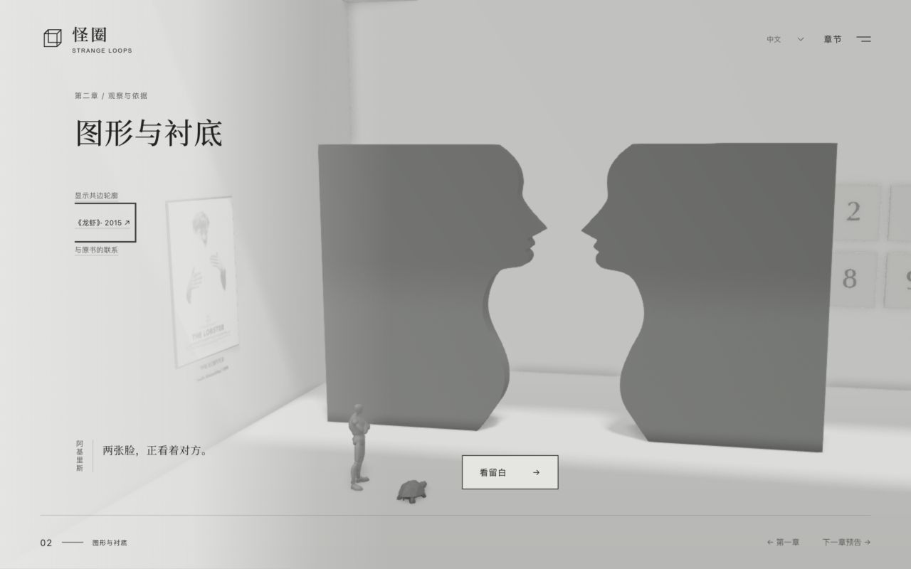
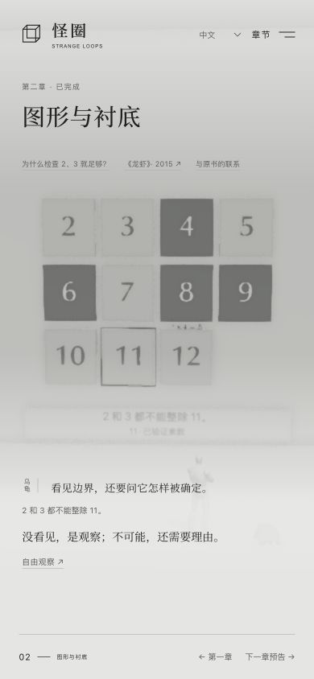
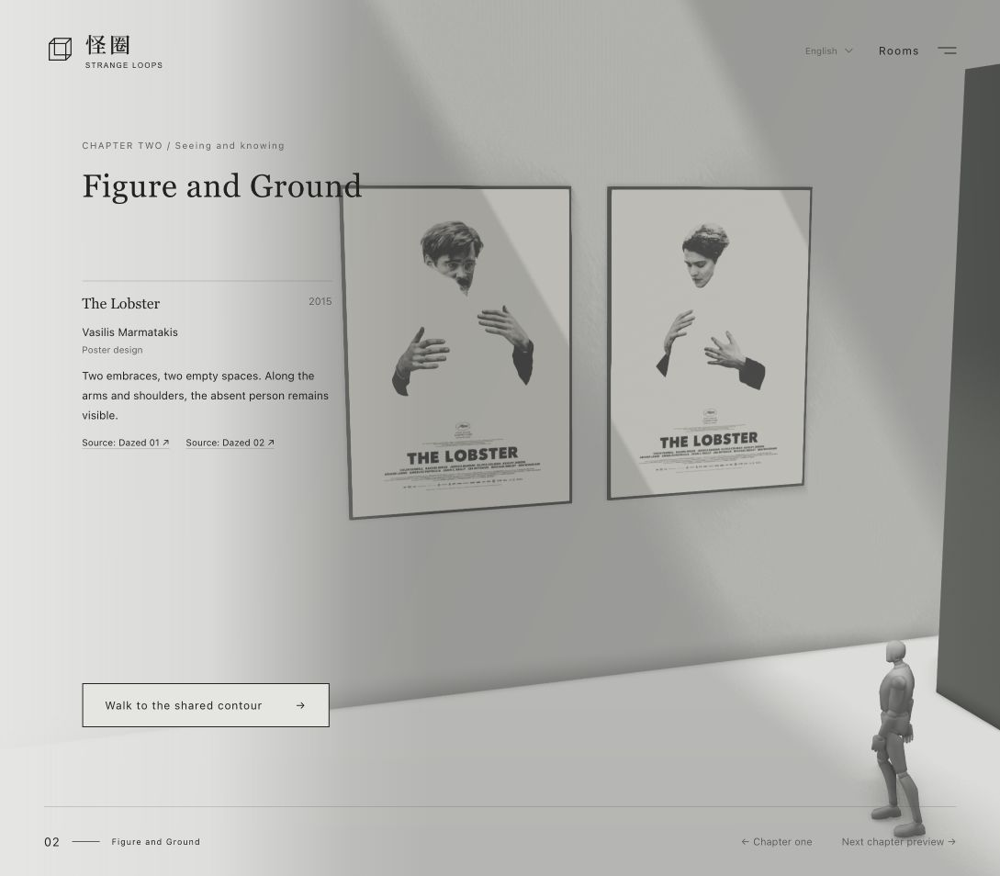
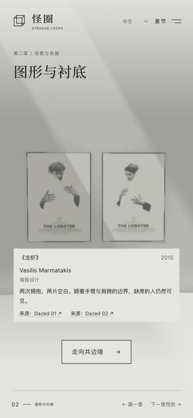
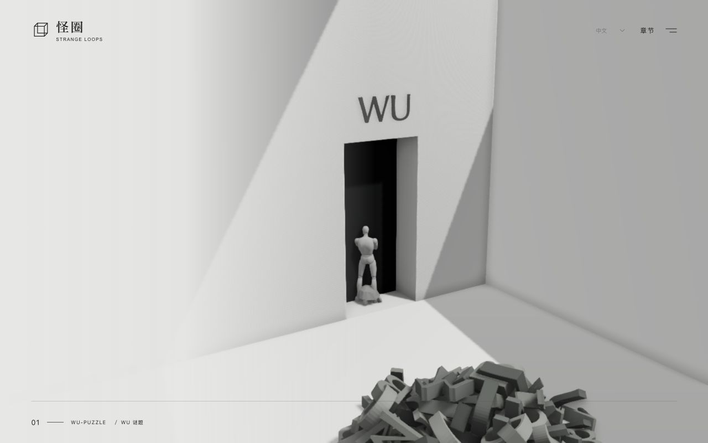
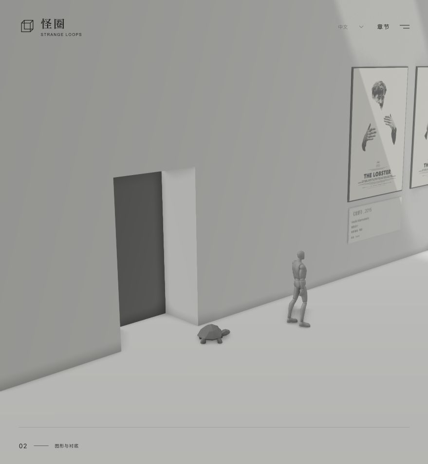

# 第二章实施与本地验收

实现基于 `main@7f44059`，纳入计划 PR #5 的 `257becc` 修订，并采用用户 2026-10-21 补充的空间方向：Rubin 轮廓成为有厚度的墙体，《龙虾》挂在侧墙，两位同行者在展品之间行走。墙体与光束使用真实几何和阴影；数字证据不作为独立课件弹出。

## 已验证

- `npm test`：60 项通过，含 8 项第二章证据、展签与迁移测试及 4 项章节穿门路线测试。覆盖六次操作、跳步与重复输入、部分生成、平方因数边界、坏存档、七语言字段和 SVG／3D 共用轮廓来源。
- `npm run build` 与 `npm run release` 通过；发布包包含第二章 CSS、原始轮廓和本地海报，28 个文件，约 4.0 MB，仍使用官网子路径和文件校验清单。此处为本地构建验证，未发布官网。
- 实际浏览器走通：《龙虾》双海报 → 共边读法 → 短划与数量 → 生成 8 → 检查 11 → 错选反馈 → 正确完成。未分类的 2、3、5、7、10、12 没有被自动标记为素数。
- 七种语言逐一切换，标题与操作随语言更新，`eleven` 阶段保持不变；完成后刷新、经地图重入，恢复完成状态。重新体验的取消保持完成，确认后只回到本章起点。
- 第一章与第二章往返可用，第一章下一章按钮直达画廊；第三章仍是可关闭的预告。海报观赏及 Esc 返回不改变学习阶段。
- 390 × 844 视口：主流程完成、预告及键盘关闭正常，页面无横向溢出。手机数字墙使用四列，桌面六列，数字顺序相同。
- 用本地 QA 服务器故意让初始三维资源返回 503，实际应用进入后备模式；SVG／HTML 版本仍能从入口完成第二章。QA 服务器位于忽略的 `work/`，不会进入发布包。
- 正常三维预览未观察到浏览器控制台错误。后备测试中的 503 与初始化错误为主动制造的测试条件，不算正常场景验证。

## 视觉调整

首轮检查修正了海报被共边墙遮挡、数字墙取景过紧、角色回应打断行走，以及展开评论与完成文案重叠。海报独立观赏位保留完整画幅与署名；关闭评论后恢复原观察对象。手机数字墙改成四列，让数字与证据更容易辨认。

下图来自实际浏览器，不是概念图。概念图仍保存在 `references/chapter-02/`，不作为网页背景。

减少动态分支直接更新相机、角色位置与证据，不以动画结束作为完成条件；已检查实现，未在真实手机系统偏好中实测。当前手机验证为浏览器视口测试，尚未做真实 iOS／Android 设备测试。

海报的来源、设计者与使用背景记录于仓库 `THIRD_PARTY_NOTICES.md`。它是评论对象，不是本展原创或可再许可的公版素材。

## 双海报、展签与穿门过渡（2026-10-21）

- 使用用户评论指定的两款 Dazed 官方海报，等高并置，保留 786 × 1113 原始画幅。海报是受场景光照影响的实体表面；墙面不再重复展示展签。页面上的美术馆式展签列出作品名、海报设计者、2015 年和 Dazed 来源；可访问 HTML 中提供两条分别对应原图的链接。
- 七语言共用海报元数据，原创评论改为对应双幅的“两次拥抱”。窄桌面与 390 × 844 竖屏均检查了作品完整可见，竖屏无横向溢出；英文采用英文展签并独立截图。
- 第一章到第二章：沿实际门洞方向走近、跨过门槛，利用门内暗部衔接，再从新空间真实的侧墙开口继续走出。镜头随路线转向，两位角色都跨过门槛后才切换空间。过程中暂停场景操作，抵达后恢复键盘焦点。减弱动态偏好及无 3D 后备直接进入。
- 路线测试检查两位角色的交点在门洞宽度内、新展厅入口先穿门再转向、拐点插值连续。第二章学习进度、第一章字串均不因穿门或观看海报而改变。正常浏览器未见控制台错误。

补充后备验证：主动让初始三维资源返回 503 后，两幅海报在 HTML 展签中均实际加载为 786 × 1113 图像，标题、设计者及两条来源链接可见。

按用户后续反馈移除墙面 3D 展签及其纹理、绘制逻辑和点击目标，作品元数据与逐幅来源仅保留在页面展签中。双海报、数学证据及章节过渡保持原样。穿门截图记录的是移除前的动线验收。

页面进一步精简：删除所有语言中的媒介／版本数量行，以及“与原书的联系”入口和展开文案，移除对应状态、事件处理与闲置翻译。

## 海报纳入主线

入馆先进入 `posters` 步骤，主按钮为「走向共边墙」，再用「看留白」观察花瓶，之后以「走向数字墙」继续。两位角色从侧墙门洞出来后沿墙停在海报前，不先走到共边墙再折返。页面不增加观看计时、额外确认题或必点外链。后续回看保留，新流程按顺序推进。版本 1、2 的有效证据迁移至版本 3，已完成存档保留；新版海报步骤可刷新和跨语言恢复。60 项测试包含主线顺序、幂等、存档迁移、入口至海报路线和海报不生成数学证据。

共边墙增加七语言鲁宾花瓶展签，包含 Edgar Rubin、1915、图底知觉研究、原创短说明及丹麦皇家图书馆原始研究链接。新增翻译覆盖与研究署名检查，总计 60 项测试。

数字墙导读明确“涂黑＝已列出乘法、未涂黑＝暂不判断、细框＝经独立检查的素数”，先交代因数都大于 1，再给出 4、6、9 的三组乘法。“没出现”改成“没有涂黑／尚未列出乘法”，按钮直接提示追加 2×4，之后单独检查 11；数学状态和判定方法保持原样。

移除共边墙的辅助描边按钮与三维描边效果。作品之间统一使用「走向海报」「走向共边墙」「走向数字墙」导航，海报不再提供「关闭」切换；回看展品保持已取得的学习证据。

最新导航回归：桌面与 390 × 844 手机视口均检查海报 → 共边墙 → 数字墙的往返，回看后仍停在 `numbers`，未提前生成 8；生成、检查、错选反馈和正确完成均正常。手机海报展签与导航按钮无重叠、页面无横向溢出。

