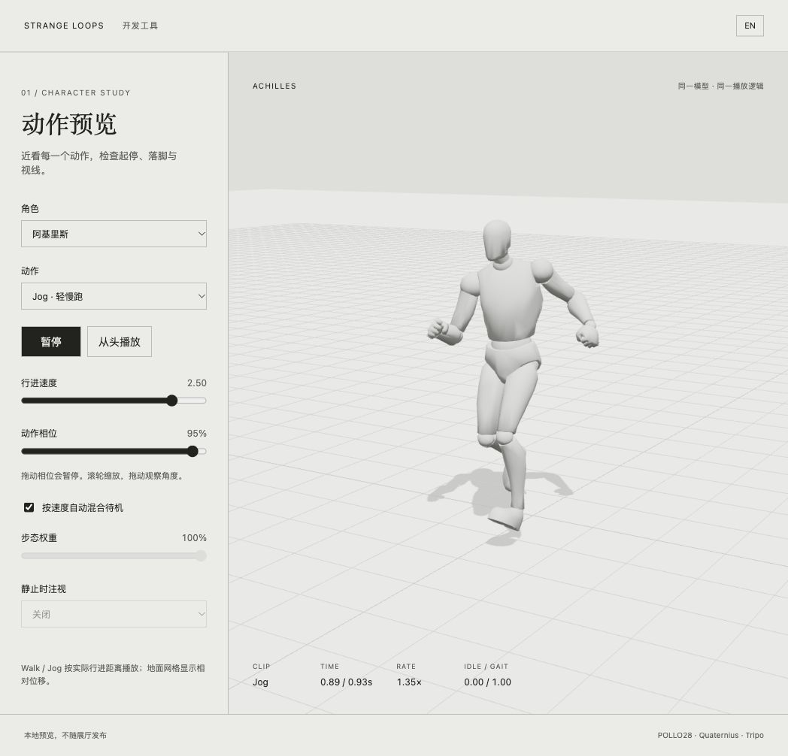
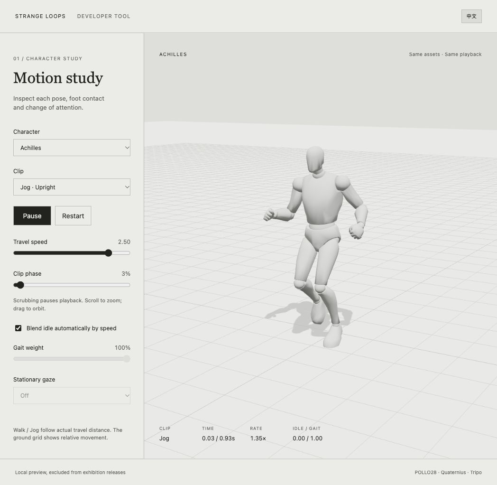

# 角色动作预览与首轮优化

本轮优先阿基里斯。保留 POLLO28 人偶、Formal 下肢落脚、原有抱臂 Idle / Look；上半身在 Blender 中融合 Quaternius `Walk_Loop`，补足自然肩臂摆动。乌龟的造型、动作、步频和路线保持现状。来源与许可仍见仓库 `THIRD_PARTY_NOTICES.md`。

## 打开本地预览

在 `outputs/strange-loop` 执行：

```sh
npm run preview:build
```

使用已有的本地服务器打开 `/clip-preview.html?lang=zh` 或 `?lang=en`。尚无服务器时，执行 `npm start` 后访问 `http://localhost:4173/clip-preview.html`。预览支持：

- 切换 Idle、Walk、Jog、Look，暂停、从头播放及相位拖动。
- 调整行进速度，观察真实的 Idle / 步态混合权重和播放倍率。
- 关闭自动混合后，手动检查 Idle 与步态的中间姿态。
- 静止时向左、右或镜头注视；拖动观察和滚轮缩放。
- 系统减少动态效果时默认暂停；用户仍可主动播放。切到后台时暂停时间推进。

预览是相对运动的观察台，人物保持在镜头中心，地面网格按累计行进距离后移。它不运行展厅路线，也不替代完整场景的过渡验收。乌龟可供对照，但不新增步距数据，也没有 Jog 或程序化头颈层。

页面复用 `companion-rig.js` 的加载、实例化和姿态更新，以及展厅相同的 `companion-animation.js` / `companion-locomotion.js`。`companion-preview-controller.js` 仅提供速度、暂停与混合输入。开发包生成在 `dev/clip-preview.js`，不提交、不放入 `assets/`；正式构建和发布不包含该页面及开发包。

## 展厅行为变化

### 自然摆臂

`refine_mannequin_arms.py` 以 `geb-companions-jog.blend` 为输入，将已有 CC0 `source/quaternius-walk-loop.glb` 的肩、上臂、肘和手腕重定向到人物。通过左右大腿运动匹配源动作相位，避免同侧手脚同向摆动。在已稳定膝盖的步行上，只替换八根肩臂骨骼的曲线，其他曲线逐项保持一致并记录哈希；另存 `geb-companions-motion.blend`，保留原工程。候选 GLB 先写入 `work/companion-motion/`，通过导出动画测试后才替换运行资产。

### 膝盖稳定

逐周期 640 段采样发现，原右膝在支撑末段距髋踝连线只有约 0.0066 模型单位，接近锁直。`retarget_ual_walk.py --soft-walk` 对 Walk 也使用源腿轴投影后的稳定膝盖方向，将骨盆降低 0.025 模型单位，为膝盖保留余量，并以循环对称四元数滤波柔化脚踝恢复段。仍逐帧适配实际鞋底高度。新右膝最小前向弯曲偏移约 0.1264；右大腿角速度峰值（按原烘焙帧间隔换算）约从 13.75° 降为 8.65°，步距和循环时长保持不变。对比数据见 `outputs/characters/mannequin-walk-quality.json`。

### 轻慢跑协调

原 Jog 躯干前倾约 15°–21°，骨盆上下幅度约 0.235 模型单位，与已缩短的腿部步幅不匹配。`--light-jog` 将躯干改为约 2.5°–5.3° 的轻微前倾；肩臂相对躯干围绕周期中性姿态收敛到 80%，避免向 T-pose 缩放；骨盆垂直变化减至原来的约 25%，脚部抬升改为源动作的 40%。新骨盆上下幅度约 0.091，仍逐帧拟合鞋底，循环保留 0.933 秒、网页步距约 1.72335。

### 起步与走跑切换

旧版 `playCompanionAnimation` 安排 0.35 秒淡入，距离驱动随后逐帧 `stopFading()`，使新步态立即获得全权重。现在由距离驱动统一管理过渡权重：从当前姿态权重平滑到速度对应的 Idle / Walk / Jog 权重，和为 1；中途反向切换从当前混合继续。

Walk / Jog 使用交付剪辑的左脚支撑中点（Formal 0.35 周期，Jog 4/28 周期）对齐切换起点，相差半周期即对应右脚。此映射只适用于当前两个剪辑，换动作时须重新校准。混合期间两条步态均按实际位移推进。慢速停止仍保留原来的 Idle 连续性处理，不额外重播抱臂动作。

这是相位与权重优化，不是运行时足部 IK；两条步态混合及转弯时不承诺脚底绝对锁地。原有单剪辑支撑脚位移、膝踝朝向和根漂移测试继续执行。

### 头颈注视

仅绑定交付人偶的 `neck_01_59`、`neck_02_58`、`head_57`。注意力通过颈部与头部分担，额外偏航不超过 28°、俯仰不超过 12°。小幅注意力变化先用头颈，身体保留最多约 14° 的相对视线偏差；远在身后的目标交给整体转身。

每帧先还原上一帧程序化叠加，再采样原动画，最后以父骨骼局部坐标叠加注视，避免逐帧累积。行走时衰减到原步态，减少动态效果时清除叠加。手臂、胸腔和腿部不受此层直接改写。

## 验证与后续范围

新增交付 GLB 上的起步权重、走跑双向切换、被打断的混合、脚部朝向、头颈限幅、抱臂保持、减少动态效果和预览暂停/相位/手动混合测试。骨骼测试保留 glTF skin 的 joint 定义，避免删除 skin 后 `.isBone` 为空而使循环接缝断言失去覆盖。

完整导出流水线、逐剪辑 manifest、网格穿插检测、Mixer 节流、额外手势和外部动画生成均留待后续。若加入穿插检测，应使用带符号距离或网格内外/交叉判定；无符号最小距离不足以区分贴身接触与穿透。本轮不新增费用、外部服务或授权条件。

本轮验证：96 项自动测试通过，正式构建与 32 文件发布包校验通过。桌面浏览器实际检查了暂停、相位、速度、走跑切换、注视、中英文切换，以及序厅到第一章、穿门进入第二章的流程；未声明移动端实机验收。乌龟交付 GLB 与修改前逐字节一致。




